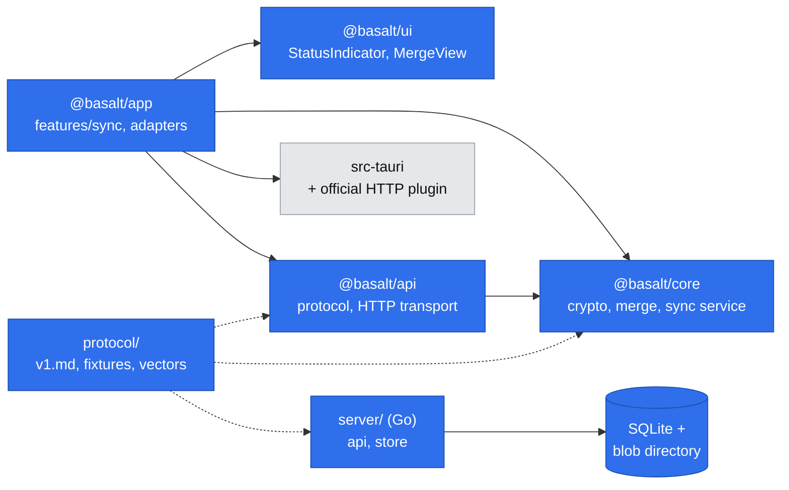
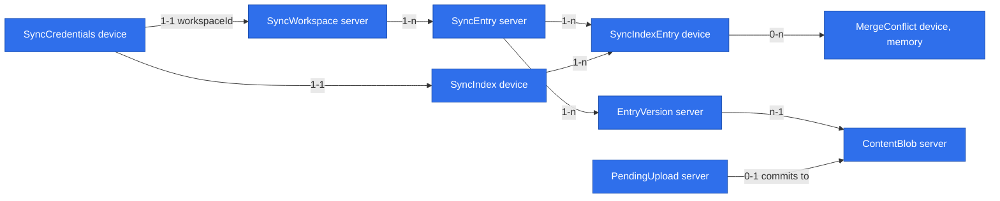

# Sync and E2EE (E02)

Source issue: #12 (E02-S01-T01, epic #6). Covers stories #11 (E02-S01, server and connection), #13 (E02-S02, client-side encryption) and #14 (E02-S03, changes sync) as one capability: a sync server without a client sync engine or without encryption ships nothing usable, and the three stories are layers of one feature. Design authority: `.ai/specs/product-brief.md` (D05, N02). Engineering law: `AGENTS.md`, `.ai/specs/implemented/2026-10-17-engineering-standards-package-structure.md`, `BACKWARD_COMPATIBILITY.md` (the "End-to-end encryption and sync format (planned)" surface). Reused work: `.ai/specs/implemented/2026-11-01-manage-notes-and-folders.md` (E01-S04) shipped `WorkspaceFileSystem.rename`, `renamePath`, the `WorkspaceTrash` port with its `move_to_trash` command, and the tree.

## 📝 TLDR

The owner has no sync today: notes live only on the device that wrote them, and the alternatives the owner tried (Google Drive, the Remote Sync plugin, paid Obsidian Sync) were not acceptable. This spec proposes [future behavior] self-hosted sync with client-side E2EE: the owner runs a Go server on their own infrastructure, enters its address and a token in Basalt, and notes, images and folders sync between their desktop and Android devices; the server stores only encrypted blobs and never sees note text or names. Concurrent edits are merged line-by-line; a real conflict opens a three-pane merge view modelled on WebStorm's merge tool. This spec adds no new Rust: the transport is the official HTTP plugin and the one custom command it reuses (`move_to_trash`) already shipped with E01-S04.

## 📝 Problem Statement

- Notes are plain Markdown files in a user-chosen workspace; the app is offline-only. `@basalt/api` is an empty placeholder package, the Tauri host registers no HTTP plugin, and no screen exists for a server address, token or key.
- The product brief makes self-hosted sync and client-side E2EE part of the MVP (D05) and rules out a Basalt-operated service for now (N02). Without this spec the E02 stories cannot start: server stack, key handling and conflict policy were the open blocking decisions.
- `BACKWARD_COMPATIBILITY.md` already reserves the E2EE and sync format as a protected surface: the wire format must be versioned from its first release.

## 📝 Acceptance criteria (from the stories)

- **E02-S01 (#11):** given a server run by the owner, when the owner enters its address, then the app connects and shows sync status; given no Basalt-operated service exists, when the owner uses sync, then it works against the owner's server only; given the server is unreachable, when the app is used, then it reports the failure and local notes remain unchanged.
- **E02-S02 (#13):** given sync is on, when a note is synced, then the data stored on the server contains no readable note text; given the same owner, when another device with the correct key syncs, then it can read the note; given a device with a wrong key, when it syncs, then it cannot decrypt and does not overwrite existing notes.
- **E02-S03 (#14):** given two devices of the owner, when a note is edited on one and synced, then the other shows the change; given edits made offline, when the device reconnects, then they sync; given the same note was edited on both devices, when both sync, then no edit is silently lost.

## 📝 Owner decisions (2026-11-16)

| Id  | Topic                 | Decision                                                                                                                                                                                                                                                                                                          |
| --- | --------------------- | ----------------------------------------------------------------------------------------------------------------------------------------------------------------------------------------------------------------------------------------------------------------------------------------------------------------- |
| S-1 | Server stack          | Go.                                                                                                                                                                                                                                                                                                               |
| S-2 | Server location       | In this repository under `server/`, with its own Go module and CI job.                                                                                                                                                                                                                                            |
| S-3 | Server-visible data   | Encrypted names too: the server sees only opaque entries.                                                                                                                                                                                                                                                         |
| S-4 | Key model             | A passphrase stretched with Argon2id, wrapping a random per-workspace master key. No generated recovery phrase.                                                                                                                                                                                                   |
| S-5 | Client authentication | One static token from the server configuration.                                                                                                                                                                                                                                                                   |
| S-6 | Conflict policy       | Merge, with a three-pane merge view modelled on WebStorm's merge tool (owner's reference, described in session 2026-11-16; not stored in the repo). Non-overlapping edits merge silently; content conflicts are resolved interactively; a name/move-only conflict resolves last-writer-wins and loses no content. |

## 📝 Proposed Solution

A small single-tenant Go server stores an opaque entry tree plus encrypted blobs. The app pushes and pulls over the official Tauri HTTP plugin; all encryption, decryption, diffing and merging happen in TypeScript in `@basalt/core`, so no plaintext or key ever leaves the device. The workspace stays plain Markdown on disk — the file is the source of truth, and sync state lives in per-device app config.

- **Server (Go, `server/`):** static binary and Docker image; SQLite for metadata, a blob directory for ciphertext; HTTP API (JSON for metadata, raw bytes for content) with a bearer token; TLS terminated by the owner's reverse proxy. One workspace per server instance, identified by a `workspaceId` fixed at initialization.
- **E2EE:** a random 256-bit master key per workspace, wrapped with AES-256-GCM by a KEK derived from the owner's passphrase with Argon2id (RFC 9106; t=3, m=64 MiB, p=4, 128-bit salt, 256-bit key). The server stores the KDF parameters and the wrapped key; it never sees the passphrase or the master key. Entry names, folder structure, file kind, content hash and content are encrypted client-side with AES-256-GCM (RFC 5116) under keys derived with HKDF-SHA-256 (RFC 5869). Every AAD binds the `workspaceId` and the entry ID; meta also binds the entry version, content binds its content version, and the meta of each version carries the SHA-256 of its content. All byte encodings are canonical and pinned by test vectors (see Data Model — Encoding).
- **Sync protocol:** versioned (`/v1`). Each write is compare-and-swap; the server assigns monotonically increasing per-entry versions (a successful write becomes exactly `baseVersion + 1`) and a workspace-wide change sequence `seq`, so a device pulls only entries changed since its cursor. Old versions are retained so a device can fetch the merge base.
- **Conflicts:** a three-way, line-based merge (diff3) per text file. A clean merge is applied and pushed automatically. Overlapping changes open the merge view: Local (read-only) | Result (editable) | Server (read-only), with per-hunk accept actions, Apply and Abort, like WebStorm. Non-text files never merge: both versions are kept, the remote one as a conflict copy. Local edits win over remote deletions and are resurrected. Folder entries sync too: remote create/rename/move/delete is applied with `mkdir`, `rename` (directories included) and the E01-S04 `WorkspaceTrash` port. Tree-level conflicts between different entries (same path, move cycles, orphans) have deterministic client-side rules.
- **Client shape:** `@basalt/core` (crypto, merge, sync service over ports), `@basalt/api` (protocol types and HTTP transport), `@basalt/app` (platform adapters, settings and merge UI wiring), `@basalt/ui` (sync states on the existing `StatusIndicator`, `MergeView` with plain props). `src-tauri` gains only the official HTTP plugin; no new Rust is needed.

### Alternatives considered

- **TypeScript/Node server:** one language and shared types, but rejected by the owner (S-1). Go gives a static single binary that is trivial to self-host; protocol types are kept honest with shared JSON fixtures and crypto test vectors instead.
- **Path-keyed sync (server sees names):** simpler, but leaks note titles and folder structure to the server and contradicts "the server never sees plaintext". Rejected by the owner (S-3).
- **Content-addressed blobs (keyed content HMAC as blob name):** considered in an earlier draft together with a client-generated content epoch. It added a second counter and a second integrity mechanism without stronger guarantees than binding the server-assigned content version in the AAD and the content hash in the versioned meta. Content-addressed dedupe across entries would also leak content equality. v1 stores one ciphertext per entry content version.
- **Full manifest on every sync:** simplest, but downloads every entry's meta every 60 s; with thousands of notes and never-collected tombstones this is megabytes per minute on mobile data. A change cursor (`seq`) is cheap now and a format change later.
- **CRDT or OT real-time collaboration (Yjs, Automerge):** real-time collaboration is Should-have (D05) and a CRDT would displace plain Markdown as the on-disk truth. A file-level merge keeps the workspace model.
- **Last-writer-wins or conflict copies for text:** rejected by the owner (S-6); losing a paragraph silently is the one outcome the acceptance criteria forbid.
- **Generated recovery phrase:** rejected by the owner (S-4). The wrapped-key design still allows a cheap passphrase change later (re-wrap only, no data re-encryption); v1 creates the workspace only and defers the re-wrap endpoint to a future version with a passphrase proof (see Open questions).
- **Accounts and passwords:** a static token fits a single-owner server and does not preclude token-per-device or accounts later (N02 design-with-Cloud-in-mind).
- **Custom Rust sync core:** forbidden by the Rust policy; no capability here needs it.

## 📝 Architecture

| Area           | Change                                                                                                                                                                                                                                                                                                                                                                                                                                                                                                                                                                                                                                          |
| -------------- | ----------------------------------------------------------------------------------------------------------------------------------------------------------------------------------------------------------------------------------------------------------------------------------------------------------------------------------------------------------------------------------------------------------------------------------------------------------------------------------------------------------------------------------------------------------------------------------------------------------------------------------------------- |
| `server/`      | New Go module at the repository root (sibling of `basalt-app/`): `cmd/basalt-server`, `internal/api` (handlers, auth, limits), `internal/store` (SQLite + blob directory, pending uploads), `Dockerfile`, `README.md` (hosting, TLS, backup and restore).                                                                                                                                                                                                                                                                                                                                                                                       |
| `protocol/`    | New neutral directory: `v1.md` (wire format and byte encodings in prose), `fixtures/` JSON request/response pairs and `fixtures/crypto/` test vectors (fixed inputs → expected AAD bytes, derived keys, ciphertexts), consumed by both the Go tests and the TypeScript contract tests, plus `check.mjs` (fixture shape + no-secret-fields check) run by CI. This is how the two languages stay in step without code generation.                                                                                                                                                                                                                 |
| `@basalt/core` | New `crypto/` (canonical encoding, Argon2id KEK with a parameter floor, wrap/unwrap, HKDF meta and per-entry content keys, AES-256-GCM meta/content), `merge/` (diff3 wrapper, conflict-copy naming), `sync/` (ports, service, index and credentials schemas, path tree with collision/cycle/orphan rules, planner including folder create/rename/move/delete), `testing/` (in-memory sync server and a transport contract suite, following the existing file-system contract pattern). `WorkspaceFileSystem` gains `writeBytesAtomic` (port, both adapters, contract suite) for downloaded binaries.                                           |
| `@basalt/api`  | Filled in: `protocol.ts` (types plus runtime validation of every response), `http-transport.ts` (`createHttpSyncTransport({ baseUrl, token, fetch })`), error mapping. Depends on `@basalt/core` for `Result` and error types only.                                                                                                                                                                                                                                                                                                                                                                                                             |
| `@basalt/app`  | `Platform` gains an injectable `fetch`-shaped HTTP client (Tauri plugin-http adapter; memory platform uses the browser `fetch`) and a `SyncStateStore` for the per-workspace credentials and index files under `$APPCONFIG/sync/` (atomic write; the fs capability gains that scope). `basalt.json` and `WorkspaceSettings` are unchanged. New `features/sync/` store and containers: settings dialog, join preview, status segment, merge screen. `createServices` builds the sync service and the workspace lifecycle starts/stops it per open workspace. Every platform uses the production HTTP transport; there is no test transport hook. |
| `@basalt/ui`   | `StatusIndicator` changes API: labels come through props (today they are hard-coded English strings), and it gains the states `connecting`, `connected`, `offline` next to `syncing`, `synced`, `conflict`, `error`; existing stories and tests are updated. Add `MergeView` (three panes, changed-line highlighting, per-hunk accept, synchronized scrolling, keyboard operable) with plain props so it does not import `@basalt/core`. Storybook stories, token checks, docs page, catalog entry and a `design-system.md` update.                                                                                                             |
| `src-tauri`    | Adds only `tauri-plugin-http` in `Cargo.toml` and `http:default` scoped to `http://`/`https://` in `capabilities/default.json`, plus `$APPCONFIG/sync/*` in the fs scope. No new commands; the existing `move_to_trash` command and its scope are untouched. The Tauri Android template already declares `INTERNET`; the plugin adds no Android code.                                                                                                                                                                                                                                                                                           |



Takeaway: arrows mean "depends on" (dotted: consumes fixtures and test vectors). The app talks to the server only through `@basalt/api`, the sync service in `@basalt/core` owns all decisions, and the Go server has no knowledge of plaintext or the client's file model.

## 📝 Data Model

### Encoding (normative, pinned in `protocol/v1.md` with test vectors)

- `enc(f1, …, fn)` concatenates, for each field, a 4-byte big-endian length followed by the field bytes. Strings are UTF-8; UUIDs are their lowercase canonical string; integers are 8-byte big-endian unsigned values. No other concatenation is used anywhere in the format.
- **KEK:** `Argon2id(password = NFC-normalized UTF-8 passphrase, salt, memoryKiB, iterations, parallelism, keyLength = 32)`.
- **Wrapped master key:** 96-bit nonce ‖ AES-256-GCM(KEK, masterKey), AAD `enc("basalt/v1/wrap", workspaceId, "argon2id", kdf.version, salt, memoryKiB, iterations, parallelism, keyLength)`. Binding the KDF parameters stops a server from swapping them unnoticed.
- **Meta key:** `HKDF-SHA-256(ikm = masterKey, salt = enc(workspaceId), info = enc("basalt/v1/meta-key"), L = 32)`.
- **Content key:** `HKDF-SHA-256(ikm = masterKey, salt = enc(workspaceId), info = enc("basalt/v1/content-key", entryId), L = 32)`.
- **Meta ciphertext:** 96-bit random nonce ‖ AES-256-GCM(metaKey, metaJson), AAD `enc("basalt/v1/meta", workspaceId, entryId, version)` where `version` is the entry version the meta is written at (always `baseVersion + 1`).
- **Content ciphertext:** 96-bit random nonce ‖ AES-256-GCM(contentKey, plaintext), AAD `enc("basalt/v1/content", workspaceId, entryId, contentVersion)` where `contentVersion` is the entry version at which this content was written (known before upload as `baseVersion + 1`).
- Random nonces under one meta key stay far below the 2^32-message bound for a single-owner workspace.

### Server (Go, SQLite + blob directory)

- **`workspace`** (single row, id = 1): `workspace_id` (UUID, client-generated at initialization), `protocol_version`, `kdf_version`, `kdf_salt`, `kdf_memory_kib`, `kdf_iterations`, `kdf_parallelism`, `wrapped_master_key` (blob), `seq` (int, last assigned change sequence), `updated_at`.
- **`entries`** (current state): `id` (UUID v4, text PK), `version` (int), `seq` (int, the workspace `seq` of the last write; indexed), `deleted` (bool), `meta` (encrypted blob, null for tombstones), `content_version` (int, null when the entry has no content), `ciphertext_size`, `updated_at`.
- **`entry_versions`** (history and merge bases): `(entry_id, version)` PK, `meta` (null for tombstones), `content_version` (nullable), `deleted`, `created_at`.
- **Blobs:** ciphertext files at `<data>/blobs/<entryId>/<contentVersion>`; the server builds the path from a validated UUID and an integer, never from client strings.
- **`uploads`** (pending content): `upload_id` (server-generated UUID), `entry_id`, `content_version`, `byte_size`, `created_at`; bytes in `<data>/uploads/<uploadId>`. A commit moves the file into the blob directory in the same transaction that writes the entry; uncommitted uploads are deleted after 24 h.
- **Encrypted meta** (client format, inside `meta`): `{ "v": 1, "name": string, "parentId": uuid | null, "kind": "file" | "dir", "content"?: { "sha256": hex, "size": int } }`. `content` is present exactly when `kind` is `file`. Because the meta of version V is authenticated with V and carries the SHA-256 of its content, the client verifies every downloaded plaintext against the hash in the meta it belongs to, compares content without downloading it, and rebuilds a lost index without fetching content.
- **Tombstones** are versions with `deleted = true`, no meta and no content; they are retained in v1 (no garbage collection) so offline devices converge. The change cursor keeps them out of routine pulls.
- **Retention:** all versions and blobs are retained in v1. Pruning is future work and degrades the merge base to a two-way choice, never to an overwrite (see Edge cases).

### Device (per workspace, `$APPCONFIG/sync/`)

`<workspaceKey>` is the hex SHA-256 of the workspace root path, filesystem-safe and stable across restarts. Both files are validated at load and written atomically; they live outside `basalt.json`, so the settings parser, which drops unknown fields and resets on a version mismatch, can never erase sync credentials. `basalt.json` and `WorkspaceSettings` are unchanged.

- **`SyncCredentials`** (`<workspaceKey>.credentials.json`): `{ formatVersion: 1, serverUrl, token, workspaceId, masterKeyB64 }`. Losing this file costs a re-join, never note data.
- **`SyncIndex`** (`<workspaceKey>.index.json`): `{ formatVersion: 1, workspaceId, cursor, entries: Record<entryId, { path, kind, parentId, version, contentVersion, sha256, mtimeMs, size }> }`, where `cursor` is the last fully pulled `seq` and `sha256` is the hash of the plaintext file. Entry IDs are random UUIDs created on first upload; the index is what makes renames and moves identity-preserving. If the index is lost, the engine rebuilds it by path and then by content hash, both taken from decrypted server meta, and warns; worst case a file is uploaded as a new entry (no data loss, possible duplicates).
- **`MergeConflict`** (in memory only): `{ entryId, path, baseText: string | null, localText, remoteText }`; `baseText: null` means no merge base was available and the UI offers a two-way choice. It is re-derived from the index and the server on every sync, so it survives an app restart without a new persisted file; nothing is pushed or overwritten while it is pending.
- **Untrusted decrypted data:** decrypted meta is validated like any other untrusted input before it touches the disk: `name` must be a single valid path segment under the existing workspace name rules (no `/` or `\`, not `.` or `..`, no control characters, no leading dot), `parentId` must be a UUID or null, and `kind`/`content` must be consistent. An entry that fails validation is skipped and reported, never written.
- **Sensitive data:** the passphrase never leaves the device; the master key leaves only wrapped. The token is sent to the owner's server as a bearer credential on every request. Locally the master key and token are stored in the app-private credentials file, not an OS keychain (a keychain is future work); the threat model is an untrusted server, not a compromised device. The server learns entry count, ciphertext sizes, versions, change timing, and whether an entry currently has content (so directories and tombstones are distinguishable from files); it cannot learn names, folder structure or content. Because the server holds the salt and wrapped key, it can brute-force the passphrase offline at Argon2id cost: passphrase strength is the whole of the confidentiality guarantee, and the setup dialog says so. No secret is logged.
- **Integrity limits (honest threat model):** the client refuses any entry version, content version or `seq` lower than what its index has seen, and a server cannot present old content as a newer version because the content AAD binds the content version and the versioned meta binds the content hash. A server can still withhold updates (freeze) or show a device that has not yet seen a newer state an older, internally consistent one (rollback across devices); v1 does not protect against either. A signed change log is future work.



## 📝 API Contracts

All paths are under `/v1`; every endpoint except health requires `Authorization: Bearer <token>` compared in constant time. Metadata bodies are JSON with base64 blobs; content travels as raw `application/octet-stream`. The server validates every field at runtime (UUID format, base64, lengths, integer ranges, version and upload consistency) and caps metadata bodies at 64 KiB and upload bodies at the content limit.

| Method | Path                                       | Body                                     | Response                                                                                                                                                                                                                                                                |
| ------ | ------------------------------------------ | ---------------------------------------- | ----------------------------------------------------------------------------------------------------------------------------------------------------------------------------------------------------------------------------------------------------------------------- |
| GET    | `/v1/health`                               | —                                        | `{ status: "ok", protocolVersion: 1, serverVersion }` (no auth)                                                                                                                                                                                                         |
| GET    | `/v1/workspace`                            | —                                        | `{ initialized, protocolVersion, workspaceId?, kdf?, wrappedMasterKey?, seq }`                                                                                                                                                                                          |
| PUT    | `/v1/workspace`                            | `{ workspaceId, kdf, wrappedMasterKey }` | `{ ok: true }` creates; 409 `already-initialized` when a workspace exists (re-wrap is future work, see Open questions)                                                                                                                                                  |
| GET    | `/v1/entries?since=&limit=`                | —                                        | `{ entries: [{ id, version, seq, deleted, meta?, contentVersion?, size, updatedAt }], next, hasMore }` ordered by `seq`; `since=0` is the full listing; `limit` defaults to 1000, max 5000                                                                              |
| GET    | `/v1/entries/{id}/versions/{version}`      | —                                        | `{ id, version, deleted, meta?, contentVersion? }` for any retained version (used for merge-base meta and orphan recovery); 404 when not retained                                                                                                                       |
| GET    | `/v1/entries/{id}/content?contentVersion=` | —                                        | ciphertext bytes (`contentVersion` omitted = current); 404 when not retained (v1 retains every version; the client still implements the two-way fallback)                                                                                                               |
| POST   | `/v1/uploads?entryId=&contentVersion=`     | ciphertext bytes                         | `{ uploadId }`; 413 `payload-too-large` above the content limit                                                                                                                                                                                                         |
| PUT    | `/v1/entries/{id}`                         | `{ baseVersion, meta, uploadId? }`       | `{ version, seq, contentVersion? }`; `baseVersion: 0` creates; the new version is always `baseVersion + 1`; with `uploadId`, the upload must match `{id, baseVersion + 1}` (else 400 `upload-mismatch`) and becomes the content; without it the current content is kept |
| DELETE | `/v1/entries/{id}?baseVersion=`            | —                                        | `{ version, seq }` tombstone (the base version is a query parameter, so no DELETE request body is required)                                                                                                                                                             |

- **Compare-and-swap:** a write succeeds only when `baseVersion` equals the current version; otherwise 409 `{ error: "version-conflict", current: { version, seq, meta, contentVersion, deleted } }`. On a lost response the client retries with the same `baseVersion`, gets 409, decrypts `current.meta` (AAD uses `current.version`) and treats `current.version === baseVersion + 1` with matching meta fields, including `content.sha256`, as success (idempotent retry). The check never relies on ciphertext bytes being equal.
- **Change cursor:** every successful write or delete increments the workspace `seq` and stamps the entry. A device pulls `GET /v1/entries?since=<cursor>` page by page and stores the new cursor only after the last page is applied. A full listing (`since=0`) runs on workspace open and after an index rebuild; it is the only pull that can detect a missing entry.
- **Limits:** 20 MiB plaintext per entry (matching `MAX_IMAGE_BYTES`; ciphertext adds 28 bytes), 8 KiB encrypted meta, 64 KiB metadata body. Content is never base64-encoded, so a 20 MiB file is held in memory as plaintext plus ciphertext only.
- **Errors:** `{ error, message }` with codes `unauthorized`, `not-found`, `version-conflict`, `already-initialized`, `upload-mismatch`, `payload-too-large`, `invalid-request`, `workspace-not-initialized`, `rate-limited`, `internal`. The client maps them to existing `AppError` codes where possible and to new sync codes otherwise. Failed authentication is rate-limited per client address (10 per minute) and answered with `rate-limited` after that.
- **KDF parameters:** `{ algorithm: "argon2id", version: 1, salt: base64(16 bytes), memoryKiB: 65536, iterations: 3, parallelism: 4, keyLength: 32 }` (RFC 9106 second recommended option); stored with the wrapped key so parameters can evolve, and re-read before every unlock. The client refuses parameters below a floor (`memoryKiB ≥ 65536`, `iterations ≥ 3`, `parallelism ≥ 1`, `keyLength = 32`, 16-byte salt) before deriving anything.
- **Client port (in `@basalt/core`, implemented by `@basalt/api` and by the in-memory fake):**

```ts
interface SyncTransport {
  getWorkspace(): Promise<Result<WorkspaceSnapshot>>;
  putWorkspace(input: WorkspaceSetup): Promise<Result<void>>;
  listEntries(input: {
    since: number;
    limit?: number;
  }): Promise<Result<EntryPage>>;
  getEntryVersion(
    entryId: string,
    version: number,
  ): Promise<Result<EntrySummary>>;
  getContent(
    entryId: string,
    contentVersion?: number,
  ): Promise<Result<Uint8Array>>;
  upload(input: {
    entryId: string;
    contentVersion: number;
    bytes: Uint8Array;
  }): Promise<Result<{ uploadId: string }>>;
  putEntry(input: PutEntryInput): Promise<Result<PutEntryOutcome>>;
  deleteEntry(input: {
    entryId: string;
    baseVersion: number;
  }): Promise<Result<DeleteEntryOutcome>>;
}
type PutEntryOutcome =
  | { kind: "applied"; version: number; seq: number }
  | { kind: "conflict"; current: EntrySummary };
interface SyncStateStore {
  loadCredentials(root): Promise<Result<SyncCredentials | null>>;
  saveCredentials(root, credentials): Promise<Result<void>>;
  loadIndex(root): Promise<Result<SyncIndex | null>>;
  saveIndex(root, index): Promise<Result<void>>;
  clear(root, scope: "index" | "all"): Promise<Result<void>>;
}
```

- **Transport details:** HTTP client from `@tauri-apps/plugin-http` (bypasses WebView CORS on Android; the server address is user-supplied so the capability scope is http/https, justified in Risks). JSON requests time out after 30 s; uploads and downloads abort after 60 s without progress; there is no cap on a whole run, and cancelling is safe because every write is a CAS. Redirects to another origin are refused; the app warns when the address is plain `http://` to a non-loopback host.

## 📝 UI/UX

- **Sync settings** (a new dialog reached from the status segment — its menu offers **Sync now** and **Sync settings…** — and from the ActivityBar's Settings section): server address, token (masked), passphrase and confirmation (masked), primary action **Enable sync** on a fresh server or **Connect** to an initialized one, **Disconnect**, and **Forget key on this device**. Inline validation and errors: unreachable server, bad token, wrong passphrase, server has no workspace, server identity changed. Passphrase minimum 12 characters; no strength meter in v1, but first enable states plainly that the passphrase is the only protection of the server copy against the server's operator and that losing every device _and_ the passphrase makes server data unrecoverable.
- **Disconnect vs. forget:** **Disconnect** stops syncing and keeps the credentials and index, so reconnecting resumes where it stopped. **Forget key on this device** deletes the credentials and index (server data is kept); the next connect is a join and asks for the passphrase.
- **Joining with existing notes:** before the first sync of a non-empty workspace, a join preview counts local-only files, remote-only entries, identical files (same path and SHA-256, linked silently) and differing files. Differing text files become two-way choices in the merge screen; differing binaries keep the local file and save the remote one as a conflict copy. The owner confirms or cancels; the dialog recommends joining into an empty folder. Nothing is written before confirmation.
- **Status:** the existing `StatusIndicator` gains the sync states — hidden when sync is off; `Connecting…`; `Connected` (Phase 2, key and server ready, no transfer yet); `Syncing…` and `Synced` with a relative time (Phase 3); `Offline` (server unreachable, local notes unaffected); `Error` with a tooltip and retry; `N conflicts` (click opens the first pending merge, Phase 4). Labels come from the app through props; accessibility follows the design-system rules (labelled controls, `aria-live` for state changes).
- **Sync triggers:** on workspace open (full listing), 3 s after a local save, on window focus, every 60 s while the window is visible (cursor pull), and **Sync now** from the status menu. Errors back off 5 s → 5 min; `unauthorized` and `rate-limited` stop automatic retries until the settings change or the owner presses retry. No WebSocket in v1.
- **Merge screen** (replaces the editor for that note; the tab shows a conflict marker): three titled panes — Local (read-only), Result (editable), Server (read-only) — changed lines highlighted, per-hunk **Accept local** / **Accept server**, a conflict counter, synchronized scrolling, and **Apply** / **Abort**. Applying writes the file atomically, pushes it with the version the merge was computed against as `baseVersion`, and re-runs the merge on a 409 instead of forcing the write. Aborting keeps the conflict pending; nothing is lost. Keyboard: Tab reaches every action, Accept actions are buttons with labels, Escape asks before aborting. Markdown is shown as plain monospaced text in v1; no syntax highlighting, no word-level diff (future). Without a merge base the screen shows two panes and a labelled two-way choice.
- **Remote changes to an open note:** applied through the existing external-change path after the app force-saves dirty open notes before each pull, so an unsaved buffer becomes a local change and goes to merge instead of being overwritten.

## 📝 Edge Cases & Failure Scenarios

| Scenario                                                                                                              | Behaviour                                                                                                                                                                                                                                                                                                                 |
| --------------------------------------------------------------------------------------------------------------------- | ------------------------------------------------------------------------------------------------------------------------------------------------------------------------------------------------------------------------------------------------------------------------------------------------------------------------- |
| Server unreachable, timed out, or 5xx                                                                                 | Status `Offline`/`Error`; local files untouched; retry with backoff; nothing queued for destructive action (AC of #11).                                                                                                                                                                                                   |
| Wrong token (401)                                                                                                     | Status `Error` "check the token"; automatic retries stop until settings change; the server rate-limits repeated failures.                                                                                                                                                                                                 |
| Wrong passphrase on a joining device                                                                                  | Unwrap fails; no workspace write, no local file changed; inline error.                                                                                                                                                                                                                                                    |
| KDF parameters below the floor                                                                                        | Refused before deriving anything; status `Error`; no key stored.                                                                                                                                                                                                                                                          |
| Device with a different master key                                                                                    | Meta/content fail authentication; engine aborts that entry, reports an error, never writes garbage or overwrites (AC of #13).                                                                                                                                                                                             |
| Server identity changed (`workspaceId` differs from local)                                                            | Every read and write stops; status "this server holds a different workspace". The owner can **Forget key** and join the new workspace; the index is discarded, local files stay untouched. A device with an old key can never push to a re-initialized server.                                                            |
| Same server reached through another address                                                                           | `workspaceId` matches, so the index is kept; only `serverUrl` in the credentials is updated.                                                                                                                                                                                                                              |
| Server restored from an older backup (`seq` below the cursor, or a known entry's version went down)                   | Status "server went back in time"; nothing is written locally or remotely. On the owner's confirmation the index is rebuilt from a full listing: identical files are linked, and differing files become two-way choices (text) or conflict copies (binaries). Nothing is lost.                                            |
| Entry in the index missing from a full listing                                                                        | Treated as a server inconsistency, never as a deletion (deletions arrive only as tombstones): status error, local file untouched, the entry is re-uploaded only after the owner confirms.                                                                                                                                 |
| Both sides edited, non-overlapping lines                                                                              | diff3 auto-merges, writes locally, pushes with CAS, status notes the merge.                                                                                                                                                                                                                                               |
| Both sides edited, overlapping lines                                                                                  | Merge screen; nothing pushed or overwritten until Apply; Abort keeps it pending.                                                                                                                                                                                                                                          |
| Both sides renamed the same entry                                                                                     | Meta conflict resolves last-writer-wins by server version; the losing rename is cosmetic and reported in the status.                                                                                                                                                                                                      |
| Both sides moved the same note                                                                                        | As above; content merges normally.                                                                                                                                                                                                                                                                                        |
| Two different entries resolve to the same path (both devices created `2026-11-16.md` offline; `Note.md` vs `note.md`) | Detected with the existing case-insensitive `pathKey`. The entry with the lexicographically greater `entryId` is renamed to `name (conflict YYYY-MM-DD HHmmss).ext` (with ` 1`, ` 2`… on collision) and the rename is pushed as a meta update with CAS, so every device converges on the same choice. Both files survive. |
| Concurrent moves create a folder cycle (A moves X into Y, B moves Y into X)                                           | The cycle member with the highest `seq` is moved back to its last parent from the index if that breaks the cycle, else to the workspace root; the move is pushed with CAS and reported in the status.                                                                                                                     |
| Folder deleted remotely while another device added a note inside it (orphan)                                          | The deleted ancestors are resurrected from their last non-deleted version (`GET /v1/entries/{id}/versions/{v}`) with a new version, consistent with "local edits win over remote deletions"; if no version is retained, the orphan moves to the workspace root. Reported in the status.                                   |
| Remote name invalid or not creatable on this OS                                                                       | The entry is not materialized and stays in the index as unmaterialized; status lists it; nothing is deleted on the server or elsewhere.                                                                                                                                                                                   |
| Remote folder created, renamed or moved                                                                               | Applied locally with `mkdir` / `rename` (directories included); open tabs of contained notes follow through the E01-S04 `renamePath` paths.                                                                                                                                                                               |
| Remote folder deleted                                                                                                 | The directory goes to the OS trash through the E01-S04 `WorkspaceTrash` port; if the trash is unavailable it stays local and the status asks the owner.                                                                                                                                                                   |
| Binary file (image, PDF) changed on both sides                                                                        | No merge: local keeps its path, the remote version is saved next to it as `name (conflict YYYY-MM-DD HHmmss).ext` (with ` 1`, ` 2`… on collision) and uploaded as a new entry; both survive.                                                                                                                              |
| Local edit, remote delete                                                                                             | Local version resurrected with a new version; status "kept because it was edited here".                                                                                                                                                                                                                                   |
| Local delete, remote edit                                                                                             | Remote edit wins; the note is recreated locally; status message; the owner can delete again.                                                                                                                                                                                                                              |
| Both deleted                                                                                                          | Tombstones converge; no-op.                                                                                                                                                                                                                                                                                               |
| Remote delete of an unchanged local file                                                                              | File goes to the OS trash through the E01-S04 `WorkspaceTrash` port; if the trash is unavailable it stays local and the status asks the owner. Never a permanent delete.                                                                                                                                                  |
| Delete or move while the note is open in a tab                                                                        | Tabs and persisted session follow through the E01-S04 `renamePath`/close paths.                                                                                                                                                                                                                                           |
| Joining device already has notes                                                                                      | Join preview first (see UI/UX); nothing written before confirmation; differing files become two-way choices or conflict copies.                                                                                                                                                                                           |
| App closed with a pending conflict                                                                                    | Re-detected on the next sync from index + server; still nothing overwritten.                                                                                                                                                                                                                                              |
| Index file lost or corrupt                                                                                            | Rebuild by path, then by content hash, both from decrypted server meta; unmatched local files upload as new entries; warning, no data loss (duplicates possible).                                                                                                                                                         |
| Lost response after a successful PUT                                                                                  | Retry gets 409; `current.version` is `baseVersion + 1` and the decrypted meta matches, including `content.sha256` → treated as success.                                                                                                                                                                                   |
| Upload committed by nobody (crash between upload and PUT)                                                             | The pending upload expires after 24 h; the next run uploads again.                                                                                                                                                                                                                                                        |
| Server pruned the merge base                                                                                          | Merge view falls back to a two-way choice (keep local / keep server), labelled as such.                                                                                                                                                                                                                                   |
| Attachment over the size limit                                                                                        | Push refused before upload with a clear error (20 MiB plaintext per entry); local file unchanged.                                                                                                                                                                                                                         |
| Server serves old content or a lower version                                                                          | A version, content-version or `seq` regression is refused; content whose SHA-256 differs from its meta, or whose AAD does not match the claimed content version, fails; nothing local is written.                                                                                                                         |
| Text detection                                                                                                        | `.md`, `.markdown` and `.txt` files that decode as UTF-8 merge as text (EOL and BOM preserved); every other file, or one that fails UTF-8 decoding, follows the binary rule.                                                                                                                                              |
| Sync writes while a note has unsaved editor state                                                                     | All open dirty notes are force-saved before the run; a pre-write stat/hash re-check aborts an entry whose file changed mid-run and turns it into a conflict.                                                                                                                                                              |
| Disk full or write failure during apply                                                                               | Original local file untouched (atomic text and byte writes); entry stays pending/conflict; error shown.                                                                                                                                                                                                                   |
| Server data directory lost                                                                                            | Notes survive on every device; a new server cannot be seeded from ciphertext without a device that still holds the key. A re-initialized server has a new `workspaceId`, so old devices stop instead of pushing.                                                                                                          |
| Two devices initialize the same empty server at once                                                                  | The first PUT wins; the second gets `already-initialized` and cannot decrypt the winner's key. v1 documents "initialize once, then join"; the losing device forgets its key and joins with the winning passphrase, local notes stay intact.                                                                               |

## 📝 Risks & Impact Review

- **Protected surface (E2EE and sync format).** This spec creates the v1 wire format. `protocol/v1.md` plus fixtures and crypto test vectors ship with the first server release; `/v1`, `protocolVersion`, `workspaceId`, the encrypted `meta.v` and the `basalt/v1/*` domain-separation labels are the version hooks. Reading v1 data is guaranteed for the lifetime of the format; changing KDF parameters or key derivation requires a new workspace setup or a future re-wrap path (wrapped key re-encryption only, no data re-encryption) and a documented migration. Passphrase change UI is not in v1; v1's workspace endpoint creates only.
- **Tauri host configuration (protected surface).** `tauri-plugin-http` with an http/https scope widens plugin permissions, and the fs capability gains `$APPCONFIG/sync/*` for the credentials and index files. Justification: the server address is user-supplied at runtime, so no narrower static scope exists; the plugin is official and scoped to the sync transport; the sync files live in the app's private config, not the workspace; the existing `move_to_trash` command and its scope are unchanged. Call both out in the PR body.
- **Rust policy.** This spec adds no Rust. The transport is the official HTTP plugin; crypto uses Web Crypto, Argon2id uses the vetted `hash-wasm` WASM package, diff3 uses `node-diff3`. The one custom command (`move_to_trash`, E01-S04) already exists and is reused unchanged.
- **New dependencies (justify per AGENTS.md).** `hash-wasm` (MIT, WASM Argon2id, no native code; Web Crypto has no Argon2), `node-diff3` (MIT, pure JS, three-way merge), `@tauri-apps/plugin-http` + `tauri-plugin-http` (official Tauri), Go: `modernc.org/sqlite` (pure Go, no cgo, keeps a static cross-compiled binary). A small in-house alternative to `node-diff3` was rejected: diff3 edge cases are a correctness risk not worth re-implementing. Argon2id at 64 MiB runs single-threaded in WASM; the Android smoke test (step 23) measures unlock time on a mid-range device.
- **Secrets.** The token and master key are stored in the app-private credentials file (not an OS keychain; a compromised device is outside the threat model); the server stores only the wrapped key. Keeping them out of `basalt.json` means a settings reset or an older app version rewriting that file cannot drop them. No secret may be logged; the HTTP adapter redacts `Authorization`, the server logs method/path/status only. The server README requires a token of at least 32 random bytes.
- **Passphrase strength.** The server can attack the wrapped key offline; a 12-character minimum without a strength meter is a v1 trade-off the setup dialog states explicitly.
- **Data loss.** The merge, tombstone, resurrection, trash, collision, cycle and rollback rules are the protections. No rule deletes a local file because something is missing; deletions only follow tombstones and only into the OS trash. The irreducible loss scenario is losing every device and the passphrase; the UI states it before enabling sync.
- **Operational burden.** The owner now runs a server: docs cover binary, Docker, Caddy TLS, backup and restore of the data directory (including what a restore does to connected devices), token rotation, and health checks. Without TLS the E2EE content is still protected, but the token is not; plain `http://` to a non-loopback host warns.
- **Performance.** First sync uploads the whole vault; progress is shown and cancellation is safe (per-entry CAS). Routine pulls transfer only entries changed since the cursor; local scans hash only candidates selected by size/mtime (plus watcher marks), not the whole vault. Content travels as raw bytes, so a 20 MiB attachment needs roughly 40 MiB of memory at peak.
- **Testing seam.** Every platform, including the memory platform used by Playwright, uses the production `createHttpSyncTransport` over `fetch`. Playwright intercepts `**/v1/**` with `context.route()` and answers from one in-memory server in the test process (`@basalt/core/testing`), shared by every page in the context; fulfilled responses carry CORS headers. No test hook or test transport ships in the app bundle, so `check-production-bundle.mjs` needs no new markers. One additional Playwright smoke runs against the real Go binary (Phase 5).
- **Product decisions.** D05 and N02 are respected: no hosting service, one owner, one workspace per server. Q01 (sharing, collaboration) stays out of scope; per-workspace master keys do not preclude per-note keys in a future format version. N01 (no iOS/web) holds: the engine is platform-agnostic TypeScript, so a future web client would only need an HTTP adapter.

## 📝 Decisions in play

- **D05** — MVP includes self-hosted sync and client-side E2EE; this spec is its design.
- **N02** — no Basalt Cloud work now; the protocol keeps a version hook for accounts and multi-tenant hosting without implementing them.
- **D02/D03** — built for the owner; success is the owner's use, so a single-token, single-workspace server is the right size.
- **Q01** — sharing and collaboration under E2EE stay out of scope (non-blocking, Should have).
- **N01** — iOS and the web stay out of the MVP (proposal status); the sync engine is platform-agnostic TypeScript, so a future web client needs only an HTTP adapter.
- **Dependency:** E01-S04 shipped on 2026-11-16 (`.ai/specs/implemented/2026-11-01-manage-notes-and-folders.md`): `WorkspaceFileSystem.rename`, `renamePath`, the `WorkspaceTrash` port with the `move_to_trash` command, and the tree. This spec reuses them, adds `writeBytesAtomic` to the same port, and adds no Rust.

## 📝 Open Questions

| Id   | Question                                                                                                                                                                                                                                                                           | Owner | Status |
| ---- | ---------------------------------------------------------------------------------------------------------------------------------------------------------------------------------------------------------------------------------------------------------------------------------- | ----- | ------ |
| OQ-1 | Merge view: the owner's WebStorm reference is not stored in the repo. Add a mockup or screenshots to this spec before Phase 4 implementation? Recommended: yes, step 18 cannot be checked against the reference without it.                                                        | owner | open   |
| OQ-2 | Scope: one spec covers stories #11, #13 and #14 (phases 2–4). Confirm the single design, or split protocol/server from client sync and merge. Recommended: keep one spec; the wire format, crypto and conflict rules have to be designed together, and the phases ship separately. | owner | open   |
| OQ-3 | Passphrase change: v1's `PUT /v1/workspace` creates only (409 `already-initialized`); re-wrap lands in a future version with a passphrase proof. Acceptable for v1? `workspaceId` and the KDF-bound wrap AAD keep a later re-wrap compatible with v1 data.                         | owner | open   |

## 📋 Phasing

1. **Phase 1 — Protocol, crypto and server core.** No user-visible change. `protocol/` v1, fixtures and crypto test vectors; Go server with store, auth, CAS, change cursor, uploads and tests; TypeScript crypto, protocol validation, HTTP transport and the in-memory fake; contract tests on both sides.
2. **Phase 2 — Connect (E02-S01).** Settings dialog, key setup and join, status segment, health check, Tauri HTTP plugin. The app connects to a real or fake server and shows `Connected`; notes still do not sync, so the segment never claims `Synced` before transfer exists.
3. **Phase 3 — Encrypted sync (E02-S02, non-conflicting part of E02-S03).** Index, planner, encrypted upload/download, renames/moves/deletes (files and folders), tree rules (collisions, cycles, orphans), join preview, attachments, triggers and backoff. Notes appear on the second device; the server stores no plaintext. Every entry changed on both sides — edit/edit, edit/delete and delete/edit — is deferred: not pushed, not overwritten, counted as pending until the merge UI lands; that safe stop is the phase's defined behaviour for conflicts. Same-path collisions already resolve with conflict copies, which lose nothing.
4. **Phase 4 — Merge and conflicts (conflicting part of E02-S03).** diff3 auto-merge, merge session, `MergeView`, conflict copies for binaries, delete/resurrect rules, status conflict count.
5. **Phase 5 — Hosting, hardening and the gate.** Server README with TLS/backup/restore/compose, a Playwright smoke against the real Go server, CI and gate updates, manual desktop and Android smoke test, full validation.

Each phase ships independently and leaves the app working; phases 2–4 are the user-visible milestones behind E02-S01, S02 and S03 in that order.

## 📋 Implementation Plan

### Phase 1 — Protocol, crypto, server core

1. `protocol/v1.md` (endpoints, encoding, domain-separation labels, threat model) plus fixtures for workspace get/put, paged entry listing, entry version, upload, entry push/pull, 409, `upload-mismatch`, auth error, rate limit, idempotent retry and tombstone, and `fixtures/crypto/` vectors for `enc`, the wrap AAD, HKDF outputs, and meta and content ciphertexts with fixed nonces. Test: a small Node checker (`protocol/check.mjs`) asserts every fixture carries a request, a response, an expected status and no secret fields, that the case list is covered, and that every vector has inputs and expected outputs; it runs in the frontend CI job. Steps 2, 4 and 5 consume these same files.
2. `server/`: Go module, config (`BASALT_LISTEN`, `BASALT_DATA_DIR`, `BASALT_TOKEN`, fail closed without a token), SQLite schema and migrations, store with CAS, workspace `seq`, content versions, pending uploads with 24 h expiry and blob storage, HTTP handlers, auth middleware with failed-auth rate limiting, request limits, graceful shutdown. Tests: handler tests over a temp store (auth, rate limit, validation, CAS 409, `already-initialized`, `upload-mismatch`, cursor paging and ordering, idempotent retry, tombstones, size limits, upload expiry, fixture requests/responses, no secret in logs) and store tests (commit atomicity between blob move and entry write).
3. Server packaging and CI: `Dockerfile` (multi-stage, non-root, `/data` volume), `compose.yml` example, Go CI job (`gofmt` check, `go vet`, `go test ./...`, build) and the Go commands added to the validation gate. Test: job green; image builds and starts with a token.
4. `@basalt/core/crypto`: canonical `enc`, Argon2id KEK (via `hash-wasm`) with the parameter floor, master-key create/wrap/unwrap with the KDF-bound AAD, HKDF meta and content keys, AES-256-GCM meta and content with workspace-, entry-, version- and content-version-bound AAD. Tests: Argon2 known-answer vectors, every `fixtures/crypto/` vector, wrap/unwrap round trip, wrong passphrase fails, tampered KDF parameters fail unwrap, parameters below the floor are refused, AAD swaps fail (other workspace, other entry, other version, other content version), content whose SHA-256 differs from its meta is rejected.
5. `@basalt/api`: protocol types and runtime validation for every response, `createHttpSyncTransport` over an injected fetch (JSON and octet-stream bodies, paging), error mapping. Tests: fixtures accepted, malformed fixtures rejected, 409, 401, 413 and `rate-limited` mapping.
6. `@basalt/core/sync` ports, credentials and index schema validation, decrypted-meta validation, and `testing/in-memory-sync-server` with a transport contract suite. Tests: the same contract runs against the in-memory fake and the HTTP transport over a fake fetch; invalid meta names (`..`, `/`, control characters, leading dot) are rejected.

### Phase 2 — Connect (E02-S01)

7. `Platform.fetch` adapter: `@tauri-apps/plugin-http` wrapper, Cargo dependency, http/https capability scope, plugin error mapping, `Authorization` redaction in errors; memory platform uses browser fetch. Tests: adapter unit test with a fake plugin, a redaction test, bundle check still passes.
8. Sync state storage: `SyncStateStore` in Tauri (credentials and index files, atomic write under `$APPCONFIG/sync/`, with the fs capability scope added) and in the memory platform. Tests: load rejects malformed files, atomic write, an older `basalt.json` rewrite leaves the credentials intact, no workspace-file writes.
9. Sync settings dialog and setup flows: enable (generate `workspaceId` and key, derive KEK, wrap, PUT workspace, store credentials), join (GET workspace, check KDF floor, unwrap, store), disconnect (keeps credentials and index), forget key (clears both), server-identity mismatch, validation, the passphrase warning and the plain-`http://` warning for non-loopback hosts. Tests: unit and component tests for each state; Storybook for the form and the status segment.
10. `StatusIndicator` API change (labels through props, new states; existing stories and tests updated) and connect wiring: hidden/off, connecting, connected, offline, error; health check on workspace open; retry/backoff with the stop on `unauthorized`/`rate-limited`; the status menu (`Sync now`, `Sync settings…`). Playwright (memory platform, HTTP transport, `context.route` to the in-memory server): enter address/token/passphrase, see `Connected`; unreachable address shows `Offline` and notes stay editable (E02-S01 acceptance).

### Phase 3 — Encrypted sync (E02-S02, non-conflicting E02-S03)

11. `writeBytesAtomic` on `WorkspaceFileSystem` (port, Tauri and memory adapters, file-system contract suite). Index and planner: scan every non-dot workspace file (Markdown, attachments and other binaries; dot paths ignored), compare size/mtime then SHA-256 (the existing workspace watcher adds candidates), map paths to entry IDs, detect local create/update/rename/delete, build the encrypted meta tree, apply remote create/update/rename/move/delete locally for files and folders (`mkdir`, `rename`, `writeTextAtomic`/`writeBytesAtomic`, `WorkspaceTrash`, `renamePath`, tab/session follow), and the tree rules: same-path collisions (case-insensitive, greater `entryId` renamed), cycle breaking, orphan resurrection, unmaterializable names. Tests: rename keeps the entry ID; remote rename updates tabs; delete goes to trash; folder create/rename/move/delete; two devices create the same path and converge on one conflict copy; `Note.md`/`note.md` collide; a move cycle resolves identically on both devices; a note added to a remotely deleted folder resurrects it; no-op on a clean tree; index rebuild from path then content hash after index loss.
12. Sync service run: cursor pull with paging, full listing on open, plan, upload + CAS push, 409 retry with decrypted-meta comparison, version/content-version/`seq` regression checks, SHA-256 verification of downloads, server-identity check, rollback detection and the confirmed rebuild, missing-entry detection, per-entry failure isolation, error/backoff, status events, force-save of dirty open notes before pull, pre-write re-check, and the deferred both-changed entry (edit/edit, edit/delete, delete/edit: nothing pushed or overwritten, counted as pending). Tests: two engines over two in-memory workspaces and one fake server — offline edits, reconnect, non-conflicting two-way sync, wrong-key device leaves local files untouched, re-initialized server stops an old device, a server rolled back to an earlier snapshot blocks writes until confirmation, an entry dropped from the listing is never deleted locally, both-changed stays untouched until Phase 4.
13. Join preview and attachments: preview counts and confirmation for non-empty workspaces; size limits, raw-byte upload, progress reporting and cancellation. Tests: preview classifies identical/differing/local-only/remote-only; nothing is written before confirmation; 20 MiB boundary; cancel mid-run leaves a consistent index.
14. Playwright: single device creates notes and an image, syncs, and the in-memory server's stored blobs and meta contain no readable note text or names; wipe the workspace and re-download restores everything (E02-S02 acceptance). Two pages in one context, routed to the same in-memory server, sync a new note and an edit (E02-S03 acceptance 1 and 2).
15. App wiring: service lifecycle per workspace, sync triggers, status updates, conflict queue placeholder. Tests: lifecycle unit tests; Playwright for focus/periodic triggers.

### Phase 4 — Merge and conflicts (conflicting E02-S03)

16. `@basalt/core/merge`: diff3 over `node-diff3`, text detection (`.md`, `.markdown`, `.txt`, valid UTF-8), clean-merge detection, conflict regions, EOL/BOM preservation, empty-base fallback, conflict-copy naming (E01-S04 name rules plus the `(conflict …)` suffix). Tests: non-overlapping edits merge, overlapping edits conflict, insert/delete boundaries, CRLF/BOM, empty base, invalid UTF-8 falls back to the binary rule.
17. Merge session and policies: in-memory conflict registry, Apply (atomic write, upload + CAS push with the merge base version, re-merge on 409), Abort, binary conflict copies, local-edit-vs-remote-delete resurrection, local-delete-vs-remote-edit recreation, remote delete to trash, two-way choices from the join preview and the rollback rebuild. Tests for every content and merge row of the Edge cases table reachable in core; the OS/UI rows (disk full, trash unavailable, app restart) move to step 20.
18. `MergeView` in `@basalt/ui`: three panes (two in the no-base mode), changed-line highlighting, per-hunk accept, synchronized scrolling, conflict counter, Apply/Abort, keyboard and screen-reader labels; stories, token checks, docs page, catalog entry and a `design-system.md` update. Container wiring in `features/sync/merge` plus i18n keys; the container maps core types to the view's plain props. Component tests for accept/apply/abort and disabled states.
19. Playwright: two pages over one routed in-memory server edit the same note — merge screen appears, accept both hunks, Apply, both devices converge; Abort leaves the conflict pending and nothing overwritten; a binary collision produces a conflict copy (E02-S03 acceptance 3).
20. Remaining OS/UI edge rows: remote delete and open-tab interaction (deleting on one device closes the tab on the other; deleting while the note is dirty keeps the local version); disk full during Apply through the memory platform's `failNextWrite` leaves the file intact; a failing trash port keeps the local file and reports; a restart with a pending conflict re-detects it without pushing. Tests for each.

### Phase 5 — Hosting, hardening and the gate

21. `server/README.md`: binary and Docker install, Caddy TLS example, token generation (at least 32 random bytes) and rotation, data-directory backup and restore (and the "server went back in time" prompt a restore causes), passphrase-loss consequences, health check; update the root README sync section and the `BACKWARD_COMPATIBILITY.md` entry to state v1 is defined by `protocol/v1.md` plus fixtures and crypto vectors.
22. Real-server smoke and validation gate: one Playwright spec runs the built Go binary through Playwright's `webServer` (a dev-only `BASALT_CORS_ORIGIN` setting, off by default, allows the test origin) and covers enable, a second page joining, and one edit syncing. Go commands and the `protocol/check.mjs` step in `.ai/agentic.config.json`, CI and `SDLC.md` contributor-tooling list; run the full gate (`format:check`, `lint`, `typecheck`, `test`, `build`, `rust:fmt`, `rust:lint`, Go checks, `test:e2e`, `check:bundle`).
23. Manual smoke on a built desktop app against a real Go server (enable, second device join with existing notes, edit, conflict, delete, server restore from backup) and on Android (connect, unlock time, pull, edit, 20 MiB attachment); record results in the spec's implementation notes.
