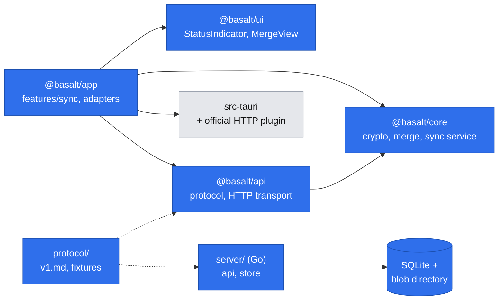
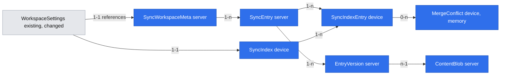

# Sync and E2EE (E02)

Source issue: #12 (E02-S01-T01, epic #6). Covers stories #11 (E02-S01, server and connection), #13 (E02-S02, client-side encryption) and #14 (E02-S03, changes sync) as one capability: a sync server without a client sync engine or without encryption ships nothing usable, and the three stories are layers of one feature. Design authority: `.ai/specs/product-brief.md` (D05, N02). Engineering law: `AGENTS.md`, `.ai/specs/implemented/2026-10-17-engineering-standards-package-structure.md`, `BACKWARD_COMPATIBILITY.md` (the "End-to-end encryption and sync format (planned)" surface). Reused work: `.ai/specs/implemented/2026-11-01-manage-notes-and-folders.md` (E01-S04) shipped `WorkspaceFileSystem.rename`, `renamePath`, the `WorkspaceTrash` port with its `move_to_trash` command, and the tree.

## 📝 TLDR

The owner has no sync today: notes live only on the device that wrote them, and the alternatives the owner tried (Google Drive, the Remote Sync plugin, paid Obsidian Sync) were not acceptable. This spec proposes [future behavior] self-hosted sync with client-side E2EE: the owner runs a Go server on their own infrastructure, enters its address and a token in Basalt, and notes, images and folders sync between their desktop and Android devices; the server stores only encrypted blobs and never sees note text or names. Concurrent edits are merged line-by-line; a real conflict opens a three-pane merge view modelled on WebStorm's merge tool. This spec adds no new Rust: the transport is the official HTTP plugin and the one custom command it reuses (`move_to_trash`) already shipped with E01-S04.

## 📝 Problem Statement

- Notes are plain Markdown files in a user-chosen workspace; the app is offline-only. `@basalt/api` is an empty placeholder package, the Tauri host registers no HTTP plugin, and no screen exists for a server address, token or key.
- The product brief makes self-hosted sync and client-side E2EE part of the MVP (D05) and rules out a Basalt-operated service for now (N02). Without this spec the E02 stories cannot start: server stack, key handling and conflict policy were the open blocking decisions.
- `BACKWARD_COMPATIBILITY.md` already reserves the E2EE and sync format as a protected surface: the wire format must be versioned from its first release.

## 📝 Acceptance criteria (from the stories)

- **E02-S01 (#11):** given a server run by the owner, when the owner enters its address, then the app connects and shows sync status; given no Basalt-operated service exists, when the owner uses sync, then it works against the owner's server only; given the server is unreachable, when the app is used, then it reports the failure and local notes remain unchanged.
- **E02-S02 (#13):** given sync is on, when a note is synced, then the data stored on the server contains no readable note text; given the same owner, when another device with the correct key syncs, then it can read the note; given a device with a wrong key, when it syncs, then it cannot decrypt and does not overwrite existing notes.
- **E02-S03 (#14):** given two devices of the owner, when a note is edited on one and synced, then the other shows the change; given edits made offline, when the device reconnects, then they sync; given the same note was edited on both devices, when both sync, then no edit is silently lost.

## 📝 Owner decisions (2026-11-16)

| Id  | Topic                 | Decision                                                                                                                                                                                                                                                                                                          |
| --- | --------------------- | ----------------------------------------------------------------------------------------------------------------------------------------------------------------------------------------------------------------------------------------------------------------------------------------------------------------- |
| S-1 | Server stack          | Go.                                                                                                                                                                                                                                                                                                               |
| S-2 | Server location       | In this repository under `server/`, with its own Go module and CI job.                                                                                                                                                                                                                                            |
| S-3 | Server-visible data   | Encrypted names too: the server sees only opaque entries.                                                                                                                                                                                                                                                         |
| S-4 | Key model             | A passphrase stretched with Argon2id, wrapping a random per-workspace master key. No generated recovery phrase.                                                                                                                                                                                                   |
| S-5 | Client authentication | One static token from the server configuration.                                                                                                                                                                                                                                                                   |
| S-6 | Conflict policy       | Merge, with a three-pane merge view modelled on WebStorm's merge tool (owner's reference, described in session 2026-11-16; not stored in the repo). Non-overlapping edits merge silently; content conflicts are resolved interactively; a name/move-only conflict resolves last-writer-wins and loses no content. |

## 📝 Proposed Solution

A small single-tenant Go server stores an opaque entry tree plus encrypted blobs. The app pushes and pulls over the official Tauri HTTP plugin; all encryption, decryption, diffing and merging happen in TypeScript in `@basalt/core`, so no plaintext or key ever leaves the device. The workspace stays plain Markdown on disk — the file is the source of truth, and sync state lives in per-device app config.

- **Server (Go, `server/`):** static binary and Docker image; SQLite for metadata, a blob directory for ciphertext; HTTP JSON API with a bearer token; TLS terminated by the owner's reverse proxy. One workspace per server instance.
- **E2EE:** a random 256-bit master key per workspace, wrapped by a KEK derived from the owner's passphrase with Argon2id (RFC 9106; t=3, m=64 MiB, p=4, 128-bit salt, 256-bit key). The server stores the KDF parameters and the wrapped key; it never sees the passphrase or the master key. Entry names, folder structure, file kind and content are encrypted client-side with AES-256-GCM (RFC 5116) and keys derived with HKDF-SHA-256 (RFC 5869): a workspace-level meta key, a per-entry content key, and a dedicated content-HMAC key. Entry IDs are bound as additional authenticated data; meta also binds the entry version, and the content HMAC binds a client-generated content epoch. The client refuses version and epoch regressions, and a server cannot replay old content as new because it cannot compute the HMAC for a new epoch.
- **Sync protocol:** a versioned manifest (`/v1`) carries every entry's encrypted meta, current version, content epoch and content HMAC; writes are compare-and-swap and the server assigns monotonically increasing per-entry versions (a successful write becomes exactly `baseVersion + 1`). Old versions are retained so a device can fetch the merge base.
- **Conflicts:** a three-way, line-based merge (diff3) per text file. A clean merge is applied and pushed automatically. Overlapping changes open the merge view: Local (read-only) | Result (editable) | Server (read-only), with per-hunk accept actions, Apply and Abort, like WebStorm. Non-text files never merge: both versions are kept, the remote one as a conflict copy. Local edits win over remote deletions and are resurrected. Folder entries sync too: remote create/rename/move/delete is applied with `mkdir`, `rename` (directories included) and the E01-S04 `WorkspaceTrash` port.
- **Client shape:** `@basalt/core` (crypto, merge, sync service over ports), `@basalt/api` (protocol types and HTTP transport), `@basalt/app` (platform adapters, settings and merge UI wiring), `@basalt/ui` (sync states on the existing `StatusIndicator`, `MergeView` with plain props). `src-tauri` gains only the official HTTP plugin; no new Rust is needed.

### Alternatives considered

- **TypeScript/Node server:** one language and shared types, but rejected by the owner (S-1). Go gives a static single binary that is trivial to self-host; protocol types are kept honest with shared JSON fixtures instead.
- **Path-keyed sync (server sees names):** simpler, but leaks note titles and folder structure to the server and contradicts "the server never sees plaintext". Rejected by the owner (S-3).
- **Content-addressed encryption with cross-entry dedupe:** one ciphertext per plaintext HMAC shared by all entries would save a little space, but it leaks content equality to the server and conflicts with entry-bound keys and AAD (a second entry could not decrypt the first entry's ciphertext). v1 stores one ciphertext per entry version and accepts the storage cost.
- **CRDT or OT real-time collaboration (Yjs, Automerge):** real-time collaboration is Should-have (D05) and a CRDT would displace plain Markdown as the on-disk truth. A file-level merge keeps the workspace model.
- **Last-writer-wins or conflict copies for text:** rejected by the owner (S-6); losing a paragraph silently is the one outcome the acceptance criteria forbid.
- **Generated recovery phrase:** rejected by the owner (S-4). The wrapped-key design still allows a cheap passphrase change later (re-wrap only, no data re-encryption); v1 creates the workspace only and defers the re-wrap endpoint to a future version with a passphrase proof (see Open questions).
- **Accounts and passwords:** a static token fits a single-owner server and does not preclude token-per-device or accounts later (N02 design-with-Cloud-in-mind).
- **Custom Rust sync core:** forbidden by the Rust policy; no capability here needs it.

## 📝 Architecture

| Area           | Change                                                                                                                                                                                                                                                                                                                                                                                                                                                                                                                                                                               |
| -------------- | ------------------------------------------------------------------------------------------------------------------------------------------------------------------------------------------------------------------------------------------------------------------------------------------------------------------------------------------------------------------------------------------------------------------------------------------------------------------------------------------------------------------------------------------------------------------------------------ |
| `server/`      | New Go module at the repository root (sibling of `basalt-app/`): `cmd/basalt-server`, `internal/api` (handlers, auth, limits), `internal/store` (SQLite + blob directory), `Dockerfile`, `README.md` (hosting, TLS, backup).                                                                                                                                                                                                                                                                                                                                                         |
| `protocol/`    | New neutral directory: `v1.md` (wire format in prose) and `fixtures/` JSON request/response pairs consumed by both the Go tests and the TypeScript contract tests, plus `check.mjs` (fixture shape + no-secret-fields check) run by CI. This is how the two languages stay in step without code generation.                                                                                                                                                                                                                                                                          |
| `@basalt/core` | New `crypto/` (Argon2id KEK, wrap/unwrap, HKDF per entry/field and a dedicated content-HMAC key, AES-256-GCM meta/content with entry-, version- and epoch-bound AAD, content epoch + HMAC), `merge/` (diff3 wrapper, conflict-copy naming), `sync/` (ports, service, index schema, path tree, planner including folder create/rename/move/delete), `testing/` (in-memory sync server, in-memory transport and a transport contract suite, following the existing file-system contract pattern; browser-safe entry for Playwright).                                                   |
| `@basalt/api`  | Filled in: `protocol.ts` (types plus runtime validation of every response), `http-transport.ts` (`createHttpSyncTransport({ baseUrl, token, fetch })`), error mapping. Depends on `@basalt/core` for `Result` and error types only.                                                                                                                                                                                                                                                                                                                                                  |
| `@basalt/app`  | `Platform` gains an injectable `fetch`-shaped HTTP client (Tauri plugin-http adapter; memory platform uses the browser `fetch`) and a `SyncIndexStore` (per-workspace file under `$APPCONFIG/sync/`, atomic write; the fs capability gains that scope). New `features/sync/` store and containers: settings dialog, status segment, merge screen. `createServices` builds the sync service and the workspace lifecycle starts/stops it per open workspace. The memory platform can inject an in-memory `SyncTransport` behind a test hook for Playwright (see Risks — Testing seam). |
| `@basalt/ui`   | Extend the existing `StatusIndicator` with sync states (`syncing`, `synced`, `connected`, `offline`, `conflict`, `error`) and labels passed through props (the component has no i18n); add `MergeView` (three panes, changed-line highlighting, per-hunk accept, synchronized scrolling, keyboard operable) with plain props so it does not import `@basalt/core`. Storybook stories, token checks, docs page, catalog entry and a `design-system.md` update.                                                                                                                        |
| `src-tauri`    | Adds only `tauri-plugin-http` in `Cargo.toml` and `http:default` scoped to `http://`/`https://` in `capabilities/default.json`. No new commands; the existing `move_to_trash` command and its scope are untouched. The Tauri Android template already declares `INTERNET`; the plugin adds no Android code.                                                                                                                                                                                                                                                                          |



Takeaway: arrows mean "depends on" (dotted: consumes fixtures). The app talks to the server only through `@basalt/api`, the sync service in `@basalt/core` owns all decisions, and the Go server has no knowledge of plaintext or the client's file model.

## 📝 Data Model

### Server (Go, SQLite + blob directory)

- **`workspace`** (single row, id = 1): `protocol_version`, `kdf_version`, `kdf_salt`, `kdf_memory_kib`, `kdf_iterations`, `kdf_parallelism`, `wrapped_master_key` (blob), `updated_at`.
- **`entries`** (current state, used by the manifest): `id` (UUID v4, text PK), `version` (int), `deleted` (bool), `meta` (encrypted blob, null for tombstones), `content_epoch` (int, null when the entry has no content), `content_hmac` (hex text, null when the entry has no content), `ciphertext_size`, `updated_at`.
- **`entry_versions`** (history and merge bases): `(entry_id, version)` PK, `meta` (encrypted blob, null for tombstones), `content_epoch` (nullable), `content_hmac` (nullable), `deleted`, `created_at`.
- **`blobs`**: ciphertext files at `<data>/blobs/<content_hmac>`; the table stores `hmac` (PK), `byte_size`, `created_at`. `content_hmac = HMAC-SHA-256(HKDF-SHA-256(masterKey, "content-hmac"), entryId || contentEpoch || plaintext)` with a canonical, length-prefixed encoding of the input. The HMAC binds the entry and its content epoch, so identical plaintext in two entries or two epochs produces different HMACs — there is no cross-entry dedupe and no content-equality leak. The only equivalent uploads are retries of the same write, and for those the server keeps the first ciphertext. The server cannot verify the HMAC and treats it as an opaque key, but validates it as 64 lowercase hex characters before using it as a file name (no path traversal).
- **Encrypted meta** (client format, inside `meta`): `{ "v": 1, "name": string, "parentId": uuid | null, "kind": "file" | "dir" }`, AES-256-GCM, key `HKDF-SHA-256(masterKey, "meta")`, fresh 96-bit nonce prepended to the ciphertext, AAD `entryId || "meta" || 1 || version` (the entry version the meta is written at, always `baseVersion + 1`). Binding the version stops a server from replaying old meta as new.
- **Encrypted content**: AES-256-GCM, key `HKDF-SHA-256(masterKey, entryId || "content")`, fresh 96-bit nonce prepended, AAD `entryId || "content" || 1`. `contentEpoch` is client-generated, starts at 1, increments on every content write and does not change on meta-only writes; the HMAC binds it and the device index stores the last synced epoch. The client refuses a manifest epoch lower than its last synced epoch, and refuses a manifest HMAC that does not match the HMAC it recomputes from the unchanged local plaintext at that epoch; a server replaying old content under a higher epoch cannot produce the matching HMAC.
- **Tombstones** are versions with `deleted = true`, no meta and no content; they are retained in v1 (no garbage collection) so offline devices converge.
- **Retention:** all versions and blobs are retained in v1. Pruning is future work and degrades the merge base to a two-way choice, never to an overwrite (see Edge cases).

### Device (per workspace, `$APPCONFIG`)

- **`WorkspaceSettings`** (existing, changed additively; `APP_SETTINGS_VERSION` stays 1): optional `sync: { serverUrl, token, masterKeyB64 }`. Unknown or missing fields are already tolerated by `parseAppSettings`; the parser gains this field. The token and master key are per-device state; the workspace on disk stays plain Markdown with no new files. Losing this file costs a re-join, never note data.
- **`SyncIndex`** (new file `$APPCONFIG/sync/<workspaceKey>.json`, validated at load; `<workspaceKey>` is the hex SHA-256 of the workspace root path, filesystem-safe and stable across restarts): `{ formatVersion: 1, serverUrl, entries: Record<entryId, { path, kind, version, contentEpoch, hash, mtimeMs, size }> }`, where `hash` is SHA-256 of the plaintext file. Entry IDs are random UUIDs created on first upload; the index is what makes renames and moves identity-preserving. If the index is lost, the engine rebuilds by path (decrypting server meta) and then by plaintext hash (fetching and hashing server content) and warns; worst case a file is uploaded as a new entry (no data loss, possible duplicates).
- **`MergeConflict`** (in memory only): `{ entryId, path, baseText: string | null, localText, remoteText }`; `baseText: null` means no merge base was available and the UI offers a two-way choice. It is re-derived from the index and the server on every sync, so it survives an app restart without a new persisted file; nothing is pushed or overwritten while it is pending.
- **Sensitive data:** the passphrase never leaves the device; the master key leaves only wrapped. The token is sent to the owner's server as a bearer credential on every request. Locally the master key and token are stored in `$APPCONFIG/basalt.json` — an app-private file, not an OS keychain (a keychain is future work); the threat model is an untrusted server, not a compromised device. The server learns entry count, ciphertext sizes, versions, epochs and timing, and can tell whether an entry currently has content (so directories and tombstones are distinguishable from files); it cannot learn names, folder structure or content. No secret is logged.



## 📝 API Contracts

All paths are under `/v1`; every response except health requires `Authorization: Bearer <token>` compared in constant time. Request bodies are JSON with base64 blobs; the server validates every field at runtime (UUID format, base64, 64-hex content HMAC, lengths, version monotonicity, content epoch monotonicity) and caps bodies at 32 MiB.

| Method | Path                                | Body                                                           | Response                                                                                                                                                                                                                            |
| ------ | ----------------------------------- | -------------------------------------------------------------- | ----------------------------------------------------------------------------------------------------------------------------------------------------------------------------------------------------------------------------------- |
| GET    | `/v1/health`                        | —                                                              | `{ status: "ok", protocolVersion: 1, serverVersion }` (no auth)                                                                                                                                                                     |
| GET    | `/v1/workspace`                     | —                                                              | `{ initialized, protocolVersion, kdf?, wrappedMasterKey?, entries: [{ id, version, deleted, meta?, contentEpoch?, contentHmac?, size, updatedAt }] }`                                                                               |
| PUT    | `/v1/workspace`                     | `{ kdf, wrappedMasterKey }`                                    | `{ ok: true }` creates; 409 `already-initialized` when a workspace exists (re-wrap is future work, see Open questions)                                                                                                              |
| GET    | `/v1/entries/{id}/content?version=` | —                                                              | ciphertext bytes (`version` omitted = current); 404 when that version is not retained (v1 retains every version; the client still implements the two-way fallback)                                                                  |
| PUT    | `/v1/entries/{id}`                  | `{ baseVersion, meta, content?, contentHmac?, contentEpoch? }` | `{ version, contentEpoch?, contentHmac? }`; `baseVersion: 0` creates; the new version is always `baseVersion + 1`; `content`, `contentHmac` and `contentEpoch` come together or not at all; content omitted reuses the current blob |
| DELETE | `/v1/entries/{id}?baseVersion=`     | —                                                              | `{ version }` tombstone (the base version is a query parameter, so no DELETE request body is required)                                                                                                                              |

- **Compare-and-swap:** a write succeeds only when `baseVersion` equals the current version; otherwise 409 `{ error: "version-conflict", current: { version, meta, contentEpoch, contentHmac, deleted } }`. On a lost response the client retries with the same `baseVersion`, gets 409, and compares `current`: it decrypts `current.meta` (AAD uses `current.version`), compares its meta fields, and treats a match together with equal `current.contentEpoch`/`current.contentHmac` as success (idempotent retry) — the check never relies on re-encrypted bytes being equal.
- **Limits:** 20 MiB plaintext per entry (matching `MAX_IMAGE_BYTES`), 8 KiB encrypted meta, 32 MiB request body (base64 adds about 33%, so the plaintext cap binds before the body cap).
- **Errors:** `{ error, message }` with codes `unauthorized`, `not-found`, `version-conflict`, `already-initialized`, `payload-too-large`, `invalid-request`, `workspace-not-initialized`, `internal`. The client maps them to existing `AppError` codes where possible and to new sync codes otherwise.
- **KDF parameters:** `{ algorithm: "argon2id", version: 1, salt: base64(16 bytes), memoryKiB: 65536, iterations: 3, parallelism: 4, keyLength: 32 }` (RFC 9106 second recommended option); stored with the wrapped key so parameters can evolve, and re-read before every unlock.
- **Client port (in `@basalt/core`, implemented by `@basalt/api` and by the in-memory fake):**

```ts
interface SyncTransport {
  getWorkspace(): Promise<Result<WorkspaceSnapshot>>;
  putWorkspace(input: WorkspaceSetup): Promise<Result<void>>;
  getContent(entryId: string, version?: number): Promise<Result<Uint8Array>>;
  putEntry(input: PutEntryInput): Promise<Result<PutEntryOutcome>>;
  deleteEntry(input: {
    entryId: string;
    baseVersion: number;
  }): Promise<Result<DeleteEntryOutcome>>;
}
type PutEntryOutcome =
  | { kind: "applied"; version: number }
  | { kind: "conflict"; current: EntrySummary };
interface SyncIndexStore {
  load(root): Promise<Result<SyncIndex | null>>;
  save(root, index): Promise<Result<void>>;
  clear(root): Promise<Result<void>>;
}
```

- **Transport details:** HTTP client from `@tauri-apps/plugin-http` (bypasses WebView CORS on Android; the server address is user-supplied so the capability scope is http/https, justified in Risks). Timeouts 30 s per request, 5 min for the initial upload run; redirects to another origin are refused; the app warns when the address is plain `http://` to a non-loopback host.

## 📝 UI/UX

- **Sync settings** (a new dialog reached from the status segment — its menu offers **Sync now** and **Sync settings…** — and from the ActivityBar's Settings section): server address, token (masked), passphrase and confirmation (masked), primary action **Enable sync** on a fresh workspace or **Connect** elsewhere, **Disconnect**, and **Forget key on this device** (keeps the server data; the next connect asks for the passphrase). Inline validation and errors: unreachable server, bad token, wrong passphrase, server has no workspace. Passphrase minimum 12 characters; no strength meter in v1. First enable shows the standard note that losing every device _and_ the passphrase makes server data unrecoverable.
- **Status:** the existing `StatusIndicator` gains the sync states — hidden when sync is off; `Connecting…`; `Connected` (Phase 2, key and server ready, no transfer yet); `Syncing…` and `Synced` with a relative time (Phase 3); `Offline` (server unreachable, local notes unaffected); `Error` with a tooltip and retry; `N conflicts` (click opens the first pending merge, Phase 4). Labels come from the app through props; accessibility follows the design-system rules (labelled controls, `aria-live` for state changes).
- **Sync triggers:** on workspace open, 3 s after a local save, on window focus, every 60 s while the window is visible, and **Sync now** from the status menu. Errors back off 5 s → 5 min. No WebSocket in v1.
- **Merge screen** (replaces the editor for that note; the tab shows a conflict marker): three titled panes — Local (read-only), Result (editable), Server (read-only) — changed lines highlighted, per-hunk **Accept local** / **Accept server**, a conflict counter, synchronized scrolling, and **Apply** / **Abort**. Applying writes the file atomically, pushes it with the version the merge was computed against as `baseVersion`, and re-runs the merge on a 409 instead of forcing the write. Aborting keeps the conflict pending; nothing is lost. Keyboard: Tab reaches every action, Accept actions are buttons with labels, Escape asks before aborting. Markdown is shown as plain monospaced text in v1; no syntax highlighting, no word-level diff (future).
- **Remote changes to an open note:** applied through the existing external-change path after the app force-saves dirty open notes before each pull, so an unsaved buffer becomes a local change and goes to merge instead of being overwritten.

## 📝 Edge Cases & Failure Scenarios

| Scenario                                             | Behaviour                                                                                                                                                                                                                                   |
| ---------------------------------------------------- | ------------------------------------------------------------------------------------------------------------------------------------------------------------------------------------------------------------------------------------------- |
| Server unreachable, timed out, or 5xx                | Status `Offline`/`Error`; local files untouched; retry with backoff; nothing queued for destructive action (AC of #11).                                                                                                                     |
| Wrong token (401)                                    | Status `Error` "check the token"; no retry storm.                                                                                                                                                                                           |
| Wrong passphrase on a joining device                 | Unwrap fails; no workspace write, no local file changed; inline error.                                                                                                                                                                      |
| Device with a different master key                   | Meta/content fail authentication; engine aborts that entry, reports an error, never writes garbage or overwrites (AC of #13).                                                                                                               |
| Both sides edited, non-overlapping lines             | diff3 auto-merges, writes locally, pushes with CAS, status notes the merge.                                                                                                                                                                 |
| Both sides edited, overlapping lines                 | Merge screen; nothing pushed or overwritten until Apply; Abort keeps it pending.                                                                                                                                                            |
| Both sides renamed the same entry                    | Meta conflict resolves last-writer-wins by server version; the losing rename is cosmetic and reported in the status.                                                                                                                        |
| Both sides moved the same note                       | As above; content merges normally.                                                                                                                                                                                                          |
| Remote folder created, renamed or moved              | Applied locally with `mkdir` / `rename` (directories included); open tabs of contained notes follow through the E01-S04 `renamePath` paths.                                                                                                 |
| Remote folder deleted                                | The directory goes to the OS trash through the E01-S04 `WorkspaceTrash` port; if the trash is unavailable it stays local and the status asks the owner.                                                                                     |
| Binary file (image, PDF) changed on both sides       | No merge: local keeps its path, the remote version is saved next to it as `name (conflict YYYY-MM-DD HHmmss).ext` (with ` 1`, ` 2`… on collision) and uploaded as a new entry; both survive.                                                |
| Local edit, remote delete                            | Local version resurrected with a new version; status "kept because it was edited here".                                                                                                                                                     |
| Local delete, remote edit                            | Remote edit wins; the note is recreated locally; status message; the owner can delete again.                                                                                                                                                |
| Both deleted                                         | Tombstones converge; no-op.                                                                                                                                                                                                                 |
| Remote delete of an unchanged local file             | File goes to the OS trash through the E01-S04 `WorkspaceTrash` port; if the trash is unavailable it stays local and the status asks the owner. Never a permanent delete.                                                                    |
| Delete or move while the note is open in a tab       | Tabs and persisted session follow through the E01-S04 `renamePath`/close paths.                                                                                                                                                             |
| App closed with a pending conflict                   | Re-detected on the next sync from index + server; still nothing overwritten.                                                                                                                                                                |
| Index file lost or corrupt                           | Rebuild by path, then by plaintext hash; unmatched local files upload as new entries; warning, no data loss (duplicates possible).                                                                                                          |
| Workspace pointed at a different server              | Index `serverUrl` mismatch resets the index after confirmation; local files stay untouched.                                                                                                                                                 |
| Lost response after a successful PUT                 | Retry gets 409; decrypted `current.meta` matches and `current.contentEpoch`/`current.contentHmac` are equal → treated as success.                                                                                                           |
| Server pruned the merge base                         | Merge view falls back to a two-way choice (keep local / keep server), labelled as such.                                                                                                                                                     |
| Attachment over the size limit                       | Push refused before upload with a clear error (20 MiB plaintext per entry); local file unchanged.                                                                                                                                           |
| Server serves old content or a lower version         | A version or content-epoch regression is refused; old content replayed under a higher epoch fails the content HMAC; nothing local is written.                                                                                               |
| Sync writes while a note has unsaved editor state    | All open dirty notes are force-saved before the run; a pre-write stat/hash re-check aborts an entry whose file changed mid-run and turns it into a conflict.                                                                                |
| Disk full or write failure during apply              | Original local file untouched (atomic write); entry stays pending/conflict; error shown.                                                                                                                                                    |
| Server data directory lost                           | Notes survive on every device; a new server cannot be seeded from ciphertext without a device that still holds the key.                                                                                                                     |
| Two devices initialize the same empty server at once | The first PUT wins; the second gets `already-initialized` and cannot decrypt the winner's key. v1 documents "initialize once, then join"; the losing device forgets its key and joins with the winning passphrase, local notes stay intact. |

## 📝 Risks & Impact Review

- **Protected surface (E2EE and sync format).** This spec creates the v1 wire format. `protocol/v1.md` plus fixtures ship with the first server release; `/v1`, `protocolVersion`, the encrypted `meta.v`, the meta AAD version and the content epoch are the version hooks. Reading v1 data is guaranteed for the lifetime of the format; changing KDF parameters or key derivation requires a new workspace setup or a future re-wrap path (wrapped key re-encryption only, no data re-encryption) and a documented migration. Passphrase change UI is not in v1; v1's workspace endpoint creates only.
- **Tauri host configuration (protected surface).** `tauri-plugin-http` with an http/https scope widens plugin permissions, and the fs capability gains `$APPCONFIG/sync/*` for the index. Justification: the server address is user-supplied at runtime, so no narrower static scope exists; the plugin is official and scoped to the sync transport; the index lives in the app's private config, not the workspace; the existing `move_to_trash` command and its scope are unchanged. Call both out in the PR body.
- **Rust policy.** This spec adds no Rust. The transport is the official HTTP plugin; crypto uses Web Crypto, Argon2id uses the vetted `hash-wasm` WASM package, diff3 uses `node-diff3`. The one custom command (`move_to_trash`, E01-S04) already exists and is reused unchanged.
- **New dependencies (justify per AGENTS.md).** `hash-wasm` (MIT, WASM Argon2id, no native code; Web Crypto has no Argon2), `node-diff3` (MIT, pure JS, three-way merge), `@tauri-apps/plugin-http` + `tauri-plugin-http` (official Tauri), Go: `modernc.org/sqlite` (pure Go, no cgo, keeps a static cross-compiled binary). A small in-house alternative to `node-diff3` was rejected: diff3 edge cases are a correctness risk not worth re-implementing.
- **Secrets.** The token and master key are stored in `$APPCONFIG/basalt.json` (app-private, not an OS keychain; a compromised device is outside the threat model); the server stores only the wrapped key. No secret may be logged; the HTTP adapter redacts `Authorization`, the server logs method/path/status only.
- **Data loss.** The merge, tombstone, resurrection and trash rules are the protections. The irreducible loss scenario is losing every device and the passphrase; the UI states it before enabling sync.
- **Operational burden.** The owner now runs a server: docs cover binary, Docker, Caddy TLS, backup of the data directory, token rotation, and health checks. Without TLS the E2EE content is still protected, but the token is not; plain `http://` to a non-loopback host warns.
- **Performance.** First sync uploads the whole vault; progress is shown and cancellation is safe (per-entry CAS). Later runs hash only candidates selected by size/mtime (plus watcher marks), not the whole vault.
- **Testing seam.** Playwright cannot share one fake server across two pages through the production HTTP transport. The memory platform exposes an in-memory `SyncTransport` behind a test hook (like `__basaltTestFs`), shared across pages through `localStorage`; production always uses the HTTP transport over `Platform.fetch`, and the bundle check markers are extended so the test transport never ships.
- **Product decisions.** D05 and N02 are respected: no hosting service, one owner, one workspace per server. Q01 (sharing, collaboration) stays out of scope; per-workspace master keys do not preclude per-note keys in a future format version. N01 (no iOS/web) holds: the engine is platform-agnostic TypeScript, so a future web client would only need an HTTP adapter.

## 📝 Decisions in play

- **D05** — MVP includes self-hosted sync and client-side E2EE; this spec is its design.
- **N02** — no Basalt Cloud work now; the protocol keeps a version hook for accounts and multi-tenant hosting without implementing them.
- **D02/D03** — built for the owner; success is the owner's use, so a single-token, single-workspace server is the right size.
- **Q01** — sharing and collaboration under E2EE stay out of scope (non-blocking, Should have).
- **N01** — iOS and the web stay out of the MVP (proposal status); the sync engine is platform-agnostic TypeScript, so a future web client needs only an HTTP adapter.
- **Dependency:** E01-S04 shipped on 2026-11-16 (`.ai/specs/implemented/2026-11-01-manage-notes-and-folders.md`): `WorkspaceFileSystem.rename`, `renamePath`, the `WorkspaceTrash` port with the `move_to_trash` command, and the tree. This spec reuses them and adds no Rust.

## 📝 Open Questions

| Id   | Question                                                                                                                                                            | Owner | Status |
| ---- | ------------------------------------------------------------------------------------------------------------------------------------------------------------------- | ----- | ------ |
| OQ-1 | Merge view: the owner's WebStorm reference is not stored in the repo. Add a mockup or screenshots to this spec before Phase 4 implementation?                       | owner | open   |
| OQ-2 | Scope: one spec covers stories #11, #13 and #14 (phases 2–4). Confirm the single design, or split protocol/server from client sync and merge.                       | owner | open   |
| OQ-3 | Passphrase change: v1's `PUT /v1/workspace` creates only (409 `already-initialized`); re-wrap lands in a future version with a passphrase proof. Acceptable for v1? | owner | open   |

## 📋 Phasing

1. **Phase 1 — Protocol, crypto and server core.** No user-visible change. `protocol/` v1 and fixtures; Go server with store, auth, CAS and tests; TypeScript crypto, protocol validation, HTTP transport and the in-memory fake; contract tests on both sides.
2. **Phase 2 — Connect (E02-S01).** Settings dialog, key setup and join, status segment, health check, Tauri HTTP plugin. The app connects to a real or fake server and shows `Connected`; notes still do not sync, so the segment never claims `Synced` before transfer exists.
3. **Phase 3 — Encrypted sync (E02-S02, non-conflicting part of E02-S03).** Index, planner, encrypted upload/download, renames/moves/deletes (files and folders), attachments, triggers and backoff. Notes appear on the second device; the server stores no plaintext. When both sides changed, the entry is deferred — not pushed, not overwritten, counted as pending — until the merge UI lands; that safe stop is the phase's defined behaviour for conflicts.
4. **Phase 4 — Merge and conflicts (conflicting part of E02-S03).** diff3 auto-merge, merge session, `MergeView`, conflict copies for binaries, delete/resurrect rules, status conflict count.
5. **Phase 5 — Hosting, hardening and the gate.** Server README with TLS/backup/compose, CI and gate updates, manual desktop and Android smoke test, full validation.

Each phase ships independently and leaves the app working; phases 2–4 are the user-visible milestones behind E02-S01, S02 and S03 in that order.

## 📋 Implementation Plan

### Phase 1 — Protocol, crypto, server core

1. `protocol/v1.md` plus fixtures for workspace get/put, entry push/pull, 409, auth error, idempotent retry and tombstone. Test: a small Node checker (`protocol/check.mjs`) asserts every fixture carries a request, a response, an expected status and no secret fields, and that the case list is covered; it runs in the frontend CI job. Steps 2 and 5 consume these same files.
2. `server/`: Go module, config (`BASALT_LISTEN`, `BASALT_DATA_DIR`, `BASALT_TOKEN`, fail closed without a token), SQLite schema and migrations, store with CAS, content epoch and blob storage, HTTP handlers, auth middleware, request limits, graceful shutdown. Tests: handler tests over a temp store (auth, validation including 64-hex content HMAC and epoch monotonicity, CAS 409, `already-initialized`, idempotent retry, tombstones, size limits, fixture requests/responses, no secret in logs) and store tests.
3. Server packaging and CI: `Dockerfile` (multi-stage, non-root, `/data` volume), `compose.yml` example, Go CI job (`gofmt` check, `go vet`, `go test ./...`, build) and the Go commands added to the validation gate. Test: job green; image builds and starts with a token.
4. `@basalt/core/crypto`: Argon2id KEK (via `hash-wasm`; t=3, m=64 MiB, p=4), master-key create/wrap/unwrap, HKDF per entry/field plus a dedicated content-HMAC key, AES-256-GCM meta/content with entry-, version- and epoch-bound AAD, content epoch + HMAC. Tests: Argon2 known-answer vectors, wrap/unwrap round trip, wrong passphrase fails, AAD entry/field/version swap fails, two entries with the same plaintext produce different HMACs and blobs, old content replayed under a higher epoch fails, fixture decrypt.
5. `@basalt/api`: protocol types and runtime validation for every response, `createHttpSyncTransport` over an injected fetch, error mapping. Tests: fixtures accepted, malformed fixtures rejected, 409 and 401 mapping.
6. `@basalt/core/sync` ports, index schema validation and `testing/in-memory-sync-server` with a transport contract suite (browser-safe entry for Playwright). Tests: the same contract runs against the in-memory fake and the HTTP transport over a fake fetch.

### Phase 2 — Connect (E02-S01)

7. `Platform.fetch` adapter: `@tauri-apps/plugin-http` wrapper, Cargo dependency, http/https capability scope, plugin error mapping, `Authorization` redaction in errors; memory platform uses browser fetch. Tests: adapter unit test with a fake plugin, a redaction test, bundle check still passes.
8. Settings and index storage: additive `WorkspaceSettings.sync` parsing/serialization, `SyncIndexStore` in Tauri (atomic write under `$APPCONFIG/sync/`, with the fs capability scope added) and memory platform. Tests: parse tolerance, atomic write, no workspace-file writes.
9. Sync settings dialog and setup flows: enable (generate key, derive KEK, wrap, PUT workspace, store key), join (GET workspace, unwrap, store), disconnect, forget key, validation, the plain-`http://` warning for non-loopback hosts. Tests: unit and component tests for each state; Storybook for the form and the status segment.
10. Status segment and connect wiring: hidden/off, connecting, connected, offline, error; health check on workspace open; retry/backoff; the status menu (`Sync now`, `Sync settings…`). Playwright: memory platform with the in-memory transport — enter address/token/passphrase, see `Connected`; unreachable address shows `Offline` and notes stay editable (E02-S01 acceptance).

### Phase 3 — Encrypted sync (E02-S02, non-conflicting E02-S03)

11. Index and planner: scan every non-dot workspace file (Markdown, attachments and other binaries; dot paths ignored), compare size/mtime then SHA-256 (the existing workspace watcher adds candidates), map paths to entry IDs, detect local create/update/rename/delete, build the encrypted meta tree, apply remote create/update/rename/move/delete locally for files and folders (`mkdir`, `rename`, `WorkspaceTrash`, `renamePath`, tab/session follow). Tests: rename keeps the entry ID; remote rename updates tabs; delete goes to trash; folder create/rename/move/delete; no-op on a clean tree; index rebuild from path then hash after index loss; `serverUrl` mismatch resets after confirmation.
12. Sync service run: manifest pull, plan, CAS push, 409 retry with plaintext comparison, content epoch/HMAC regression checks, idempotent retry, per-entry failure isolation, error/backoff, status events, force-save of dirty open notes before pull, pre-write re-check, and the deferred both-changed entry (nothing pushed or overwritten, counted as pending). Tests: two engines over two in-memory workspaces and one fake server — offline edits, reconnect, non-conflicting two-way sync, wrong-key device leaves local files untouched, both-changed stays untouched until Phase 4.
13. Attachments and binary files: size limits, streaming-free base64 upload within the body cap, progress reporting and cancellation. Tests: 20 MiB boundary, cancel mid-run leaves a consistent index.
14. Playwright: single device creates notes and an image, syncs, and the in-memory server's stored blobs contain no readable note text; wipe the workspace and re-download restores everything (E02-S02 acceptance). Two pages share one in-memory transport (test hook + `localStorage`; extend the `check-production-bundle.mjs` markers) and sync a new note and an edit (E02-S03 acceptance 1 and 2).
15. App wiring: service lifecycle per workspace, sync triggers, status updates, conflict queue placeholder. Tests: lifecycle unit tests; Playwright for focus/periodic triggers.

### Phase 4 — Merge and conflicts (conflicting E02-S03)

16. `@basalt/core/merge`: diff3 over `node-diff3`, clean-merge detection, conflict regions, EOL/BOM preservation, empty-base fallback, conflict-copy naming (E01-S04 name rules plus the `(conflict …)` suffix). Tests: non-overlapping edits merge, overlapping edits conflict, insert/delete boundaries, CRLF/BOM, empty base.
17. Merge session and policies: in-memory conflict registry, Apply (atomic write, CAS push with the merge base version, re-merge on 409), Abort, binary conflict copies, local-edit-vs-remote-delete resurrection, local-delete-vs-remote-edit recreation, remote delete to trash. Tests for every content and merge row of the Edge cases table reachable in core; the OS/UI rows (disk full, trash unavailable, app restart) move to step 20.
18. `MergeView` in `@basalt/ui`: three panes, changed-line highlighting, per-hunk accept, synchronized scrolling, conflict counter, Apply/Abort, keyboard and screen-reader labels; stories, token checks, docs page, catalog entry and a `design-system.md` update. Container wiring in `features/sync/merge` plus i18n keys; the container maps core types to the view's plain props. Component tests for accept/apply/abort and disabled states.
19. Playwright: two pages over one in-memory server edit the same note — merge screen appears, accept both hunks, Apply, both devices converge; Abort leaves the conflict pending and nothing overwritten; a binary collision produces a conflict copy (E02-S03 acceptance 3).
20. Remaining OS/UI edge rows: remote delete and open-tab interaction (deleting on one device closes the tab on the other; deleting while the note is dirty keeps the local version); disk full during Apply through the memory platform's `failNextWrite` leaves the file intact; a failing trash port keeps the local file and reports; a restart with a pending conflict re-detects it without pushing. Tests for each.

### Phase 5 — Hosting, hardening and the gate

21. `server/README.md`: binary and Docker install, Caddy TLS example, token generation/rotation, data-directory backup and restore, passphrase-loss consequences, health check; update the root README sync section and the `BACKWARD_COMPATIBILITY.md` entry to state v1 is defined by `protocol/v1.md` plus fixtures.
22. Validation gate: Go commands and the `protocol/check.mjs` step in `.ai/agentic.config.json`, CI and `SDLC.md` contributor-tooling list; run the full gate (`format:check`, `lint`, `typecheck`, `test`, `build`, `rust:fmt`, `rust:lint`, Go checks, `test:e2e`, `check:bundle`).
23. Manual smoke on a built desktop app against a real Go server (enable, second device join, edit, conflict, delete) and on Android (connect, pull, edit); record results in the spec's implementation notes.
