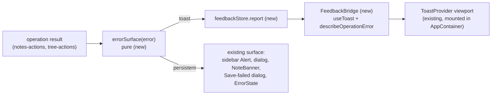

# Informational conflicts appear as toasts (E01-S08)

Prototype: `prototypes/workspace-basic/` (screen map: `prototypes/e01-screen-map.md`). The prototype already shows toasts (delete, `ToastBridge` in `src/ui/WorkspaceWindow.tsx`) and a sidebar notice for a move collision (`src/model/reducer.ts`); no new screens. Screen ids (s03, s09, …) refer to that map.

Source issue: #33 (E01-S08, epic #5). Depends on: #16 (E01-S04, manage notes and folders, implemented in PR #28). Builds on `.ai/specs/implemented/2026-11-01-manage-notes-and-folders.md` (the "S04 spec" — the inline errors and collision messages this replaces), `.ai/specs/2026-10-24-markdown-notes-and-app-foundations.md` (the "S01 spec" — the persistent banners that stay), `.ai/specs/2026-11-16-rename-move-delete-folders.md` (the "S05 spec") and `.ai/specs/2026-11-16-note-name-follows-first-heading.md` (the "S06 spec" — its title error becomes a toast here). Design authority: `.ai/specs/product-brief.md`. Engineering law: `AGENTS.md`, `.ai/specs/implemented/2026-10-17-engineering-standards-package-structure.md` (the "standards spec") and `basalt-app/packages/ui/docs/design-system.md` (rule 6: an error that needs the user to act is an Alert or a banner, never a Toast).

## 📝 TLDR

The owner (the only confirmed user, D02) sees informational messages stay on screen: after a failed move the sidebar keeps `"Testowa.md" already exists in the destination. Nothing was moved.` until the next successful operation. The `ToastProvider` from `@basalt/ui` exists, is tested and storied, but is not mounted anywhere in the app. This spec (future behavior) mounts it and routes every operation result through one classification: informational, non-actionable messages (collisions, partial failures where nothing is lost) become toasts that auto-dismiss; anything the owner must act on — save failures, a lost workspace, a read-only or scope-denied workspace, a failed listing — keeps its persistent banner, dialog or sidebar Alert.

## 📝 Decisions (owner)

| Id  | Topic       | Decision                                                                                                                                                                                      |
| --- | ----------- | --------------------------------------------------------------------------------------------------------------------------------------------------------------------------------------------- |
| D-1 | Toast scope | Toasts only for informational messages where there is nothing to do; anything the owner must act on stays an Alert, banner or dialog (owner, 2026-11-16).                                     |
| D-2 | No actions  | No Undo or Retry inside a toast. The existing dialogs and banners keep their actions; `ToastOptions.action` stays unused by the app (issue #33 out of scope; S04 "Not doing" keeps its rule). |

## 📝 Acceptance criteria

The issue's five criteria are refined below; the derived ones make the classification and the accessibility scope explicit. Screen ids refer to the screen map.

| Id      | Criterion                                                                                                                                                                                                                                                                                                                                                                                            | Screen            |
| ------- | ---------------------------------------------------------------------------------------------------------------------------------------------------------------------------------------------------------------------------------------------------------------------------------------------------------------------------------------------------------------------------------------------------- | ----------------- |
| AC-08.1 | Given a rename to an existing name, when the owner submits it, then the collision is rejected inline in the dialog and nothing changes (S04 AC-04.1, S05 AC-05.1); when the same collision happens without a dialog — a heading commit (S06 AC-06.4) or a race after the dialog closed — then a toast with the message appears and dismisses automatically, and the sidebar shows no message for it. | s03, s09, s11     |
| AC-08.2 | Given several informational messages in a row (for example two move collisions), then they stack with the newest at the bottom, at most three are visible, a fourth drops the oldest, and each visible toast can be dismissed with its close button.                                                                                                                                                 | s09, s14          |
| AC-08.3 | Given a save failure, then the persistent banner or the Save-failed dialog with its actions appears, not a toast; given a read-only or scope-denied workspace, then the R-4 message appears, not a toast.                                                                                                                                                                                            | s03, s05, s09–s14 |
| AC-08.4 | Given `prefers-reduced-motion: reduce`, then the toast appears without motion: no animation and no transition on the toast.                                                                                                                                                                                                                                                                          | s09, s14          |
| AC-08.5 | Given a screen reader, then the toast is announced through the notifications region and the focused element does not change.                                                                                                                                                                                                                                                                         | s09, s14          |
| AC-08.6 | Given a visible toast, then its auto-dismiss pauses while the pointer or focus is inside it and resumes on leave; the close button is keyboard-reachable and Escape dismisses the focused toast.                                                                                                                                                                                                     | s09, s14          |
| AC-08.7 | Given a move or delete that partially failed, then the report (`tree.move.stopped`, `tree.move.linksNotUpdated`, `tree.delete.partial`) appears as a toast; nothing is lost and the tree shows the result.                                                                                                                                                                                           | s09, s14          |
| AC-08.8 | Given an event that produced a toast, then no sidebar Alert or dialog message for the same event remains: the sidebar shows only persistent errors, and the dialog's message disappears with the dialog.                                                                                                                                                                                             | s09, s11          |
| AC-08.9 | Every toast text and the notifications region and dismiss labels shown by the app come from `locales/en.json`; `Toast.tsx` keeps only the English defaults for its stories.                                                                                                                                                                                                                          | all               |

## 📝 Not doing

- **Toast actions (Undo, Retry, "Rename instead").** The issue's out of scope; D-2, and S04 "Not doing" keeps "no Toast with Undo".
- **Replacing the Save-failed dialog.** It stays the surface for unsaved text that could not be saved (S01 AC-01.13).
- **Changing the error catalogue.** `AppError` codes and `AppErrorDetail` kinds are unchanged; the classification reads them.
- **Toasting successful operations** (for example "Note moved to trash"). The prototype shows one; the issue asks for informational _conflicts_ only (YAGNI).
- **The attachments notice** (`NoteSessionEditor`, skipped files). It is already dismissible and scoped to the note; unchanged.
- **The workspace-lost, access-needed and list-error surfaces.** They are actionable and stay as they are (`WorkspaceMain`, `WorkspaceSidebar` `ErrorState`).
- **A notification center or history.** A dismissed toast is gone.
- **Deduplicating repeated messages.** Two identical collisions produce two toasts; a follow-up at most.
- **Settings for duration or stack size.** Constants.

## 📝 Problem statement

- The owner tested epic E01 and reported the stale message (owner feedback, 2026-11-16, issue #33): after dropping a note onto a folder that already holds it, `"Testowa.md" already exists in the destination. Nothing was moved.` stays in the sidebar as a warning Alert until the next successful create, move or delete. The owner moved on; the message did not.
- Evidence: issue #33; `WorkspaceSidebar.tsx:91-95` renders `createError` as an `Alert`; `notes-actions.ts:507` (move) and `tree-actions.ts:190-212` (delete) set it; `notes-actions.ts:315` sets it for a failed create. The prototype already treats a delete as a toast and a move collision as a sidebar notice (`prototypes/workspace-basic/src/model/reducer.ts`), so the message surface is inconsistent with the design reference.
- The `ToastProvider`, `useToast` and `ToastOptions` are exported from `@basalt/ui` (`src/index.ts:54-56`), covered by `Toast.test.tsx` and `Toast.stories.tsx`, but no app file imports them: the provider is never mounted.
- Who: the owner, the only confirmed user (D02).

## 📝 Proposed solution

One classification, one toast path, no new surfaces:

1. **Mount the existing provider.** `AppContainer` wraps its content in `ToastProvider` (labels from i18n) and mounts a `FeedbackBridge` next to `SaveFailedDialogContainer`.
2. **Classify every operation result once.** A new pure `features/feedback/error-surface.ts` maps an `AppError` (code plus `detail`) to `"toast"` or `"persistent"`. The matrix follows the issue's enumeration and design-system rule 6.
3. **Report through a small service.** Actions (plain functions, outside React) push toast-bound errors into a `FeedbackStore`; the `FeedbackBridge` container drains them into `useToast` with the existing operation-error text (`describeOperationError`, moved from `describeMoveError`). Persistent errors keep their current sinks (`createError` sidebar Alert, dialog inline error, note banner, Save-failed dialog).
4. **Keep the modal rule.** While the rename or new-folder dialog is open it owns its errors (field validation and `operationError` stay inline); no toast is emitted for them. The sidebar never showed them, so nothing stale remains.
5. **Make the provider app-ready.** `ToastProvider` gains a maximum stack (3), a monotonic id, and `label`/`dismissLabel` props so the region and close button are translatable.

Alternatives considered and rejected:

- **Toasting directly from the actions.** Actions are plain functions created in `createServices` outside React; `useToast` is a hook. A store plus a bridge keeps actions framework-free and matches the prototype's `ToastBridge`.
- **Clearing the sidebar Alert on a timer.** A hand-rolled toast on top of `Alert` loses the announcement region, stacking, pause-on-hover and keyboard dismissal that Radix already provides; the standards spec prefers the existing primitive.
- **A new toast component in `@basalt/ui`.** The primitive exists, is tested and storied (design-system rule 3: build from the components).
- **Closing the rename dialog and toasting its collision.** The dialog is the context; the owner fixes the name in place (Obsidian keeps its rename dialog open on a collision too). The sidebar never showed this error, so there is nothing stale to fix.
- **Toasting successful operations.** Not requested (Not doing).

## 📝 Architecture

- **`@basalt/ui`.** `components/Toast.tsx`: `MAX_VISIBLE_TOASTS = 3` (a fourth toast drops the oldest), ids from a `useRef` counter instead of `Date.now() + length`, and two additive props on `ToastProvider` — `label` (default `"Notifications"`) and `dismissLabel` (default `"Dismiss"`) — passed to `ToastPrimitive.Provider` and the close `IconButton`. `toastContext.ts` and the `ToastOptions` shape are unchanged; `src/index.ts` exports are unchanged. Radix already pauses the timer on hover and focus, announces through the labelled region, supports Escape on a focused toast and F8 to focus the region, and the component uses no animation (the motion tokens in `tokens/semantic.css` are 0 under `prefers-reduced-motion`).
- **`@basalt/app`, new `features/feedback/`.** `error-surface.ts` (pure classification), `feedback-store.ts` (pending messages with ids), `feedback.ts` (`createFeedback({ store, setPersistent })`), `FeedbackBridge.tsx` (drains into `useToast`, translates via `describeOperationError`, passes `TOAST_DURATION_MS`), `describe-error.ts` (moved from `features/tree/move-error.ts`, renamed `describeOperationError`; the S05 spec's `describeMoveError` reference follows the rename).
- **`@basalt/app`, wiring.** `services.ts` creates the feedback store and service, passes `feedback` into `createNotesActions` and `createTreeActions`, and exposes `feedbackStore` on `Services`. `notes-actions.ts`: `createNoteNow` and `moveNotes` report operation failures through `feedback` instead of `createError` (the pre-operation flush failure stays persistent); `tree-actions.ts`: `confirmDelete` reports through `feedback`. `AppContainer.tsx` mounts `ToastProvider` and `FeedbackBridge`. `WorkspaceSidebarContainer.tsx` keeps rendering `createError` (now persistent errors only) with the moved import. `i18n/locales/en.json` gains `toasts.regionLabel` and `toasts.dismissLabel`; toast texts reuse `tree.move.*`, `tree.delete.partial`, `errors.*` and (S06) `notes.titleError.*`.
- **`src-tauri`.** No change: no new command, permission or dependency.



Takeaway: every operation error takes exactly one path; informational errors never reach the sidebar, and persistent errors never become toasts.

## 📝 Data model

No new entities and no persisted-format change. The classification, the pending messages and the visible toasts live in memory only; `basalt.json` and the workspace on disk are untouched (`BACKWARD_COMPATIBILITY.md` "Workspace on disk" is unchanged). New in-memory state: `FeedbackState { messages: readonly FeedbackMessage[] }` in the feedback store, and the `ToastProvider`'s React state. No data-model graph: this section adds or changes no entities.

## 📝 API contracts

```ts
// @basalt/ui — components/Toast.tsx (additive; ToastOptions unchanged)
type ToastProviderProps = {
    children: ReactNode;
    label?: string; // default "Notifications"
    dismissLabel?: string; // default "Dismiss"
};
const MAX_VISIBLE_TOASTS = 3; // module constant, not a prop

// @basalt/app — features/feedback/error-surface.ts (new, pure)
type ErrorSurface = "toast" | "persistent";
function errorSurface(error: AppError): ErrorSurface;

// @basalt/app — features/feedback/feedback-store.ts (new)
type FeedbackMessage = { readonly id: number; readonly error: AppError };
type FeedbackState = { readonly messages: readonly FeedbackMessage[] };
type FeedbackStore = StoreApi<FeedbackState>;
function createFeedbackStore(): FeedbackStore;
function report(store: FeedbackStore, error: AppError): void; // appends, id + 1
function drain(store: FeedbackStore, upToId: number): void; // removes id <= upToId

// @basalt/app — features/feedback/feedback.ts (new)
const TOAST_DURATION_MS = 5000; // module constant
type Feedback = { report(error: AppError): void };
function createFeedback(options: {
    readonly store: FeedbackStore;
    readonly setPersistent: (error: AppError) => void;
}): Feedback;

// @basalt/app — features/feedback/describe-error.ts (moved; renamed)
function describeOperationError(t: TFunction, error: AppError): string;

// @basalt/app — features/feedback/FeedbackBridge.tsx (new)
function FeedbackBridge(): null;

// @basalt/app — services.ts (changed)
createNotesActions({ …, feedback: Feedback });
createTreeActions({ …, feedback: Feedback });
type Services = { …, readonly feedbackStore: FeedbackStore };
```

`errorSurface` is the whole matrix, applied to tree and note-operation results only (note-session save/open errors keep their existing surfaces):

| Error (code or detail)                                                       | Surface    |
| ---------------------------------------------------------------------------- | ---------- |
| `already-exists`, `not-found`, `invalid-path`                                | toast      |
| `move-collision`, `move-stopped`, `linksNotUpdated`, `delete-failed` details | toast      |
| `permission-denied`, `scope-denied`, `unavailable`, `unknown`                | persistent |
| `conflict`, `too-large`, `not-utf8`, `not-a-file`, `unsupported`             | persistent |
| `flush-failed` (S05 detail)                                                  | persistent |

`createFeedback.report` routes by `errorSurface`: a toast error is appended to the store; a persistent error calls `setPersistent` (wired to `notesStore.setState({ createError })`). A successful create or move clears `createError` as today; `confirmDelete` gains the same clear on success, so a persistent message never outlives its cause. The bridge drains by id (`drain(store, lastId)`), so a StrictMode double effect cannot show a toast twice.

## 📝 UI/UX

| Surface                         | Used for                                                                                                 | Behaviour                                                                                                 |
| ------------------------------- | -------------------------------------------------------------------------------------------------------- | --------------------------------------------------------------------------------------------------------- |
| Toast (bottom viewport)         | Informational results: collisions, partial failures where nothing is lost, a failed heading commit       | Auto-dismiss after 5 s, pause on hover/focus, manual close, stack of at most 3, announced, no focus steal |
| Sidebar Alert (`createError`)   | Persistent operation errors: read-only, scope denied, unavailable, unknown, a failed pre-operation flush | Stays until the next successful operation; the R-4 text for read-only                                     |
| Dialog inline (`NameDialog`)    | Errors inside the rename/new-folder dialog (validation and operation)                                    | Scoped to the dialog; no toast while a modal is open                                                      |
| `NoteBanner` (above the editor) | Note-level save/open problems: conflict, deleted file, permission denied, too large, not UTF-8           | Persistent, with its actions (S01 AC-01.12)                                                               |
| Save-failed dialog              | Unsaved text that could not be saved while leaving                                                       | Retry / Discard / Cancel (S01 AC-01.13)                                                                   |
| `ErrorState` (sidebar)          | The listing failed                                                                                       | Persistent, with Retry                                                                                    |
| Workspace banners (main)        | Workspace lost, access needed                                                                            | Persistent, with their actions                                                                            |

- **Duration and stack.** 5 s per toast (the provider's existing Radix default, now explicit as `TOAST_DURATION_MS` in the feedback module); at most 3 visible; a fourth drops the oldest; the newest is at the bottom of the column (the viewport is bottom-anchored).
- **Placement.** The existing viewport: fixed 12 px from the bottom edge, full width on narrow screens and bottom-right on `tablet:` and up (`Toast.tsx` classes); it sits over the status bar as today. No change.
- **Dismissal.** Close button (keyboard-reachable), Escape on the focused toast, F8 focuses the region (Radix). Swipe is available but pointer-only.
- **Accessibility.** Radix announces the toast through the labelled notifications region without moving focus; the focused element (for example the tree row) stays focused. The region label and the close label come from `toasts.regionLabel` / `toasts.dismissLabel`.
- **Reduced motion.** The toast has no entrance or exit animation; if one is added it must use `--bs-motion-feedback-duration`, which is 0 under `prefers-reduced-motion` (`tokens/semantic.css`).
- **i18n.** Toast texts reuse `tree.move.collision`, `tree.move.stopped`, `tree.move.linksNotUpdated`, `tree.delete.partial`, `errors.*` and `notes.titleError.*`; only the two new `toasts.*` keys are added. No user-facing string is hardcoded in `Toast.tsx`.
- **The dialog rule.** A modal owns its errors: the rename and new-folder dialogs keep their field `error` and `operationError` (`TreeOverlaysContainer.tsx:164-173`), and the dialog stays open on a collision so the owner can fix the name (AC-08.1). No toast is emitted while a modal is open.

## 📝 Edge cases & failure scenarios

| Scenario                                                      | Behaviour                                                                                                               |
| ------------------------------------------------------------- | ----------------------------------------------------------------------------------------------------------------------- |
| A move collision (the reported case)                          | Nothing moves; a toast names the first colliding note; the sidebar shows nothing; the tree and selection are unchanged. |
| A create-note race (`already-exists` after `suggestNoteName`) | A toast; no sidebar Alert; no ghost row.                                                                                |
| Rename to a colliding name in the dialog                      | Rejected inline before submit (S04 AC-04.1, S05 AC-05.1); the dialog stays open; no toast.                              |
| A file appears between validation and submit (race)           | The dialog shows the operation error inline and stays open; no toast while it is open.                                  |
| A heading commit collides or is invalid (S06)                 | A toast with the title error; the file keeps its name and text; the owner keeps typing.                                 |
| A partial move (`move-stopped`, `linksNotUpdated`)            | A toast names the note and the counts; moved notes stay moved; no text is lost; the owner can retry.                    |
| A partial delete (`delete-failed`)                            | A toast reports how many were not deleted; deleted notes stay deleted.                                                  |
| A pre-operation flush fails during a move                     | Persistent: the sidebar Alert and the note's own banner; nothing moves.                                                 |
| A save fails while leaving a note                             | The Save-failed dialog, not a toast (AC-08.3).                                                                          |
| A read-only or scope-denied workspace                         | The R-4 message in the sidebar Alert or the dialog; nothing changes; no toast (AC-08.3).                                |
| The listing fails                                             | The sidebar `ErrorState` with Retry; no toast.                                                                          |
| The workspace is lost                                         | The existing workspace banner; no toast.                                                                                |
| Four or more messages in a row                                | The oldest is dropped; the newest three stay, each dismissible.                                                         |
| A toast is hovered or focused                                 | The timer pauses and resumes on leave (Radix).                                                                          |
| The window loses focus while a toast is visible               | The timer pauses (Radix pauses on hover, focus and window blur) and resumes when the window regains focus.              |
| The same event reports twice                                  | It cannot: `errorSurface` routes each error to exactly one surface; the bridge drains by id.                            |
| A toast is visible when the workspace changes                 | It stays until its duration; it reports a past event.                                                                   |
| A very long file name in the message                          | The toast wraps; the viewport width is `w-overlay` on `tablet:` and up.                                                 |
| A screen reader is active                                     | The toast is announced through the region; focus does not move (AC-08.5).                                               |
| `prefers-reduced-motion: reduce`                              | The toast appears with no animation or transition (AC-08.4).                                                            |

## 📝 Risks & impact review

- **Hard to reverse:** none new. No persisted state, no schema, no on-disk format, no Tauri permission, no Rust, no dependency. `@basalt/ui` changes are additive props plus an internal constant; `BACKWARD_COMPATIBILITY.md` protected surfaces are untouched.
- **The classification is a user-visible contract.** Once the owner relies on a collision auto-dismissing, reverting to a persistent Alert is a UX change. Low risk; the matrix is one pure function and one table.
- **Transient partial-failure reports.** `move-stopped`, `linksNotUpdated` and `delete-failed` auto-dismiss, so the owner may miss them; the tree shows the result and the operation can be retried. Recorded as an accepted trade-off of AC-08.7.
- **The dialog refinement (AC-08.1).** The issue's rename criterion says "a toast"; this spec keeps the collision inline in the dialog (the dialog owns its context) and toasts the same collision when no dialog is open. Obsidian behaves the same way (general knowledge, not freshly verified): its rename dialog keeps the error under the field, while a failed move shows a transient notice. Flagged for the owner.
- **The S06 title alert is superseded.** The S06 spec planned a dismissible alert above the editor for a failed heading commit; this spec makes it a toast (same information, no stale surface). The S06 owner decisions D-1…D-7 are untouched. Flagged for the owner.
- **`ToastProvider` gains a cap.** Existing stories and tests show fewer than three toasts and are unaffected; a new test covers the cap.
- **Radix advises against stacking distinct foreground toasts.** The toasts keep the default `type="foreground"` (they are results of a user action, so they are announced immediately); the cap of 3 bounds the stack. Recorded, not changed.
- **Market check (2026-11-17, general knowledge, not freshly verified).** Obsidian shows short top-right notices for results ("Failed to rename file: …") and keeps its rename dialog open with the error on a collision; VS Code uses bottom-right notifications, dismissible and announced, with actions for failures; macOS Finder uses a modal with Keep Both / Stop / Replace for a collision (actionable, so not a toast); GNOME Files shows a persistent banner for a failed operation. All of them keep the transient/persistent split this matrix uses; the parts they add that this spec skips are toast actions, a notification center and per-app placement settings.
- **What tests can and cannot prove.** Playwright runs on the memory platform, so it proves app behavior, not real-disk or real-watcher behavior; the S01/S04 approach to that limit is unchanged. The auto-dismiss timing is proven with Vitest fake timers and one Playwright wait.

## 📝 Decisions in play

- **D02** (built for the owner first) — justifies the small stack and the owner's message-surface preference.
- **D05** (MVP = local Markdown notes) — this spec refines feedback surfaces; no scope change.
- **The owner decision of 2026-11-16 (D-1)** — implemented here; the answers behind the resolved assumptions are the gate answers.
- **S04 "Not doing: no Toast with Undo"** — kept (D-2, Not doing).
- **S04 AC-04.13 and S05 AC-05.1** — unchanged in wording; the collision message moves from the sidebar Alert to a toast (S04) or stays inline in the dialog (S05).
- **S06's title alert** — proposed to be superseded by the toast (⚠ in Resolved assumptions); the S06 title rules D-1…D-7 are untouched.
- **Design-system rule 6** — the matrix follows it; no superseding entry.
- The S05 spec's `describeMoveError` reference follows the rename to `describeOperationError`.

## Resolved assumptions (autonomous defaults)

| #   | Open question                                                                             | Chosen answer                                                                                                                                                                                                                                         | Rationale                                                                                                                                                                                  |
| --- | ----------------------------------------------------------------------------------------- | ----------------------------------------------------------------------------------------------------------------------------------------------------------------------------------------------------------------------------------------------------- | ------------------------------------------------------------------------------------------------------------------------------------------------------------------------------------------ |
| Q1  | Which exact errors are informational and which need a persistent component?               | The `errorSurface` table: collisions, `not-found`, `invalid-path` and partial-failure details are toasts; read-only, scope denied, unavailable, unknown, save and note errors are persistent. ⚠ NEEDS HUMAN CONFIRMATION for the partial-failure row. | The issue enumerates the persistent set (save failed, workspace lost, read-only, scope denied) and calls collisions "similar recoverable feedback"; design-system rule 6 decides the rest. |
| Q2  | What duration and maximum stack are right for this app?                                   | 5 s per toast; at most 3 visible; a fourth drops the oldest.                                                                                                                                                                                          | 5 s is the provider's existing Radix default; 3 covers "several in a row" without covering the sidebar; both are constants, trivially reversible.                                          |
| Q3  | Should a toast appear while the rename dialog is still open, and should the dialog close? | No toast while a modal is open; the dialog keeps its inline error and stays open. ⚠ NEEDS HUMAN CONFIRMATION (refines AC-08.1).                                                                                                                       | The dialog is the owner's context and the sidebar never showed this error; closing the dialog would lose the name the owner was editing.                                                   |
| Q4  | Should the toast pause on hover and focus?                                                | Yes.                                                                                                                                                                                                                                                  | Radix already pauses on hover and focus; the spec only locks it in with a test.                                                                                                            |
| Q5  | Do we need an action button later (for example "Rename instead")?                         | Not now; `ToastOptions.action` stays unused by the app.                                                                                                                                                                                               | The issue's out of scope; D-2; YAGNI.                                                                                                                                                      |
| Q6  | Does the S06 title alert stay an alert above the editor?                                  | No: the title error becomes a toast (the alert is superseded). ⚠ NEEDS HUMAN CONFIRMATION.                                                                                                                                                            | The issue names name collisions as toasts; the message is informational (the file keeps its name and text) and the alert would be a second, stale surface.                                 |

## 📋 Phasing

1. **PR A, ui.** `ToastProvider`: max stack, monotonic ids, `label`/`dismissLabel`; tests and stories. No app change.
2. **PR B, feedback module.** `error-surface.ts`, `feedback-store.ts`, `feedback.ts`, `FeedbackBridge.tsx`, the `describe-error.ts` move; `services.ts` wiring; unit tests. No visible change.
3. **PR C, surfaces.** Mount `ToastProvider` and `FeedbackBridge` in `AppContainer`; route create/move/delete errors through `feedback`; i18n keys; update the existing e2e that assert `.bs-alert` for collisions; new `toasts.spec.ts`. e2e for AC-08.1…08.9.

Closes #33 on PR C only.

## 📋 Implementation plan

Each step is testable and leaves the application working. Per phase: Vitest next to the code, Storybook for the `Toast` change, Playwright in `basalt-app/e2e/` (a new `toasts.spec.ts` plus updates to `move-notes.spec.ts`, `delete-notes.spec.ts`, `manage-notes.spec.ts` and `workspace.spec.ts`), and the validation gate from `SDLC.md`.

**Phase A — ui (PR A)**

1. `Toast.tsx`: `MAX_VISIBLE_TOASTS = 3` and a `useRef` id counter; appending a fourth toast drops the oldest. Tests in `Toast.test.tsx`: three visible, a fourth drops the first, dismissal by id still works.
2. `ToastProvider` `label` and `dismissLabel` props with the current defaults; the region and close button use them. Tests: a custom label appears on the region and the close button; `Toast.stories.tsx` unchanged behavior.
3. Storybook: the `Toast` playground shows the stack cap; `npm run safety-net` green.

**Phase B — feedback module (PR B)**

4. `error-surface.ts`: the table above, every `AppError` code and detail covered; tests assert the exact surface per code and detail.
5. `feedback-store.ts`: `report` appends with increasing ids; `drain(upToId)` removes drained messages and is idempotent; tests.
6. `feedback.ts`: `createFeedback` routes toast errors to the store and persistent errors to `setPersistent`; tests.
7. Move `features/tree/move-error.ts` to `features/feedback/describe-error.ts` and rename the function to `describeOperationError`; update `WorkspaceSidebarContainer.tsx` and `move-error.test.ts`; tests stay green.
8. `FeedbackBridge.tsx`: drains messages into `useToast` (mock context), translates via `describeOperationError`, passes `TOAST_DURATION_MS`, renders nothing, and shows each message once under StrictMode; tests.
9. `services.ts`: create the feedback store and service, pass `feedback` into `createNotesActions` and `createTreeActions`, expose `feedbackStore`. Tests with the harness: a toast error lands in the store, a persistent error sets `createError`.

**Phase C — surfaces (PR C)**

10. `AppContainer`: wrap in `ToastProvider` (labels from `t("toasts.*")`) and mount `FeedbackBridge`; `i18n/locales/en.json` gains `toasts.regionLabel` and `toasts.dismissLabel`. `AppContainer.test.tsx`: a move collision shows the toast text and no sidebar Alert.
11. `notes-actions.ts`: `createNoteNow` and `moveNotes` report through `feedback`; the pre-operation flush failure stays persistent; `notes-actions.test.ts` updated (toast message for collisions, `createError` only for persistent errors).
12. `tree-actions.ts`: `confirmDelete` reports through `feedback`; `tree-actions.test.ts` updated.
13. Update the existing e2e: `move-notes.spec.ts` collision tests (lines ~289 and ~516) expect the toast text and no `.bs-alert`; `delete-notes.spec.ts` and `manage-notes.spec.ts` keep their read-only and dialog expectations.
14. New `toasts.spec.ts`: AC-08.1 (move collision toast, auto-dismiss, no sidebar message), AC-08.2 (stacking, cap of 3, each dismissible), AC-08.3 (save failure banner/dialog, read-only Alert), AC-08.4 (`reducedMotion: "reduce"`, no animation or transition), AC-08.5 (announced in the region, focus unchanged), AC-08.6 (pause on hover/focus, Escape and the close button), AC-08.7 (partial move report), AC-08.8 (no stale sidebar or dialog message), AC-08.9 (texts from the catalogue).
