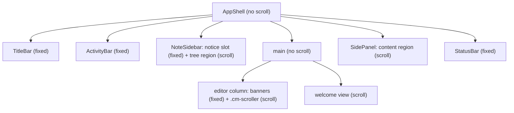

# Scrolling and scrollbars follow one model (E01-S09)

Prototype: `prototypes/scroll-model/` (new; screen map: `prototypes/e01-screen-map.md`). Screen ids (s02, s03, s09, s14) refer to that map. The prototype is Phase 0 and settles the scrollbar style before any implementation.

Source issue: #35 (E01-S09, epic #5). Depends on: #16 (E01-S04, manage notes and folders, implemented in PR #28). Builds on `.ai/specs/2026-10-24-markdown-notes-and-app-foundations.md` (the "S01 spec"), `.ai/specs/implemented/2026-11-01-manage-notes-and-folders.md` (the "S04 spec"), `.ai/specs/implemented/2026-10-30-design-system-window-shell.md` (the "shell spec") and `.ai/specs/implemented/2026-11-08-live-preview-editor.md`. The two specs in this PR (`2026-11-16-rename-move-delete-folders.md`, `2026-11-16-note-name-follows-first-heading.md`) are orthogonal: they change what the sidebar shows and when, not who scrolls. Design authority: `.ai/specs/product-brief.md`. Engineering law: `AGENTS.md` and `.ai/specs/implemented/2026-10-17-engineering-standards-package-structure.md` (the "standards spec").

## 📝 TLDR

The owner (the only confirmed user, D02) tested epic E01 and found the scrolling inconsistent (issue #35, 2026-11-16): the failed-move error grows a scrollbar inside the sidebar next to the tree, and the right-side scrollbar belongs to the whole shell (`AppShell`'s `main` scrolls) instead of the editor. This spec (future behavior) defines one model — every region that can be taller than its box owns exactly one scroller, the shell never scrolls, and notices live in a fixed slot outside the scroller — fixes the two reported symptoms, introduces scrollbar design tokens, and puts a prototype before implementation, per the owner decision of 2026-11-16.

## 📝 Decisions (owner)

| Id  | Topic             | Decision                                                                                                                                                                                                                       |
| --- | ----------------- | ------------------------------------------------------------------------------------------------------------------------------------------------------------------------------------------------------------------------------ |
| D-1 | Prototype first   | Scrollbars and nested scrolling get their own issue and a prototype before implementation (owner, 2026-11-16). The prototype settles the scrollbar style, the notice placement and the macOS overlay behavior.                 |
| D-2 | Style (prototype) | To be recorded from the Phase 0 prototype before Phase 1 starts. The spec's default (thin, always visible on Windows/Linux; the platform overlay on macOS) is the prototype's starting point, not a substitute for its review. |

## 📝 Acceptance criteria

The issue's five criteria are refined below; the derived ones make the model explicit. Screen ids refer to the screen map.

| Id      | Criterion                                                                                                                                                                                                                                                                      | Screen                  |
| ------- | ------------------------------------------------------------------------------------------------------------------------------------------------------------------------------------------------------------------------------------------------------------------------------ | ----------------------- |
| AC-09.1 | Given a long tree and an informational message in the sidebar (the watcher-fallback notice or a failed-move error), then the tree region is the only scroller in the sidebar, the message sits in the fixed slot above it, and no second scrollbar appears inside the sidebar. | s09                     |
| AC-09.2 | Given a long note, then the editor scrolls inside its own region (`.cm-scroller`) and the app shell does not scroll; the rightmost scrollbar belongs to the editor.                                                                                                            | s03                     |
| AC-09.3 | Given a failed move or rename, then the error appears in the sidebar's fixed notice slot and does not introduce an extra scrollbar next to the tree; the tree keeps its scroll position.                                                                                       | s14                     |
| AC-09.4 | Given Windows, Linux and macOS, then scrollbars follow the design tokens where the platform draws them (size, thumb, hover, track) and remain usable with mouse, trackpad and keyboard; macOS keeps the platform overlay behavior.                                             | s09, s03                |
| AC-09.5 | Given a narrow window (at least 320 px), then every region keeps its defined scroll owner and no horizontal scrolling appears; long names truncate.                                                                                                                            | s02, s03, s09           |
| AC-09.6 | The shell never scrolls: `main` has no scrollbar at any content size and the window fills the viewport (the `window.spec.ts` assertion holds).                                                                                                                                 | s02, s03                |
| AC-09.7 | Each region has exactly one scroll owner per the matrix: sidebar tree, editor, side panel, welcome view; dialogs, menus, popovers and toasts are portaled and own their scroll; no region nests a second scroller.                                                             | s02, s03, s09, s10, s13 |
| AC-09.8 | When a notice, banner or error appears or disappears, the scroll owner does not change; no scrollbar is added to or removed from the shell; the region keeps its width and its scrollbar stays at the region's edge.                                                           | s03, s09, s14           |
| AC-09.9 | Keyboard: the focused tree row is scrolled into view by the browser, the editor scrolls with the keyboard while focused, and the welcome view's scroller is reachable with Tab (inset focus ring).                                                                             | s02, s03, s09           |

## 📝 Not doing

- **Mobile layout (E04, #38).** The model must not block it: one scroller per region and token-based sizes let E04 change the shell per breakpoint. No drawer, breakpoint or touch work here (the issue's out of scope).
- **Message content (E01-S08, #33).** The wording and the toast/notice split stay that story; this spec only places notices.
- **Virtualized trees.** A long tree scrolls natively; no windowing (the issue's out of scope).
- **A custom scrollbar for the editor.** `.cm-scroller` keeps native scrolling with the token treatment; no overlay implementation inside CodeMirror.
- **Horizontal scrollbars.** Content truncates (tree rows already `truncate`) or wraps (the editor has line wrapping); no region scrolls horizontally.
- **A settings toggle for scrollbar visibility.** No settings screen exists in E01 (S01 spec, out of scope).
- **Restyling the macOS overlay scrollbars.** The OS draws them; the app does not force them visible there.
- **Changing the tab overflow model.** The title bar already uses `overflow-hidden` plus the "Show all open notes" menu (shell spec, owner decision 6).

## 📝 Problem statement

- The owner's E01 test findings (2026-11-16, issue #35) recorded two symptoms: a failed move or rename grows a scrollbar inside the sidebar next to the tree, and the right-side scrollbar belongs to the whole shell rather than the editor.
- The cause is visible in the code: `AppShell`'s `main` has `overflow-y-auto` (`basalt-app/packages/ui/src/product/AppShell.tsx:40`), so the shell is a scroll owner; `WorkspaceSidebar` renders the operation error `Alert` inside `NoteSidebar`'s scroll region (`basalt-app/packages/app/src/features/workspace/WorkspaceSidebar.tsx:91-95` inside `NoteSidebar.tsx:45`), so the error shares the tree's scroller and the sidebar grows a scrollbar; no scrollbar tokens exist (`basalt-app/packages/ui/src/tokens/component.css`); and `ScrollArea`'s `.bs-scroll-area` class has no CSS rule and the component has no consumer in the app. The existing `add-images.spec.ts` test ("a long note scrolls inside the editor and not in the pane") already asserts the pane does not overflow for a long note; the shell scroller is still there, just not always overflowing — the model removes it structurally.
- The cost: the owner sees two scrollbars where one is expected and the error can scroll out of view; the scrollbar look differs per region and platform; and with no documented owner per region, every new region (the side panel outline, future screens) risks a new nested scroller.
- Who: the owner, the only confirmed user (D02).

## 📝 Proposed solution

One rule, applied to every region: **a region that can be taller than its box owns exactly one scroller; the shell never scrolls; notices, banners and errors live in a fixed slot of their region, outside its scroller.**

Scroll-owner matrix (the target; "current" is the code today):

| Region                              | Scroll owner (the only scroller)                                         | Current                                                                          | Target                                                                              |
| ----------------------------------- | ------------------------------------------------------------------------ | -------------------------------------------------------------------------------- | ----------------------------------------------------------------------------------- |
| Workspace tree / sidebar            | `NoteSidebar`'s content region (`div.min-h-none.flex-1.overflow-y-auto`) | the same region also holds the operation error `Alert`                           | the tree is its only content; notices move to the fixed slot above it               |
| Editor                              | CodeMirror's `.cm-scroller` (`packages/editor/src/theme.ts:14`)          | `AppShell`'s `main` also scrolls                                                 | `main` stops scrolling; the column is `h-full`; `.cm-scroller` is the only scroller |
| Main shell                          | none                                                                     | `main` has `overflow-y-auto`                                                     | `main` becomes `overflow-hidden`; no page scroll                                    |
| Welcome / no-note view              | the view's own root                                                      | `main` scrolls                                                                   | the welcome view root becomes the scroller (works at a short or narrow viewport)    |
| Right side panel                    | `SidePanel`'s content region (`div.min-h-none.flex-1.overflow-y-auto`)   | not used in the app yet (E01 has no outline panel)                               | unchanged; it already follows the model                                             |
| Dialogs, menus, popovers, toasts    | the overlay itself (Radix portal)                                        | portaled outside the shell (`Dialog`, `Menu`, `ContextMenu`, `Popover`, `Toast`) | unchanged; an overlay never creates a shell scroll region                           |
| Title bar tabs                      | none (`ul.overflow-hidden` + the "Show all open notes" menu)             | already the overflow-menu model                                                  | unchanged                                                                           |
| Title bar, activity bar, status bar | none (fixed height)                                                      | fixed                                                                            | unchanged                                                                           |

The two reported symptoms are fixed by two placement changes: the sidebar operation error moves from the tree's scroller into `NoteSidebar`'s existing notice slot (the same slot the watcher-fallback notice uses), and `AppShell`'s `main` stops scrolling so the editor's `.cm-scroller` is the rightmost scrollbar.

Scrollbar treatment: **native scrolling with one token-driven thin treatment** applied to each scroll owner (a single utility in `@basalt/ui/src/styles.css`), plus the same tokens in the CodeMirror theme for `.cm-scroller`. macOS keeps the platform's overlay behavior; the prototype confirms (D-1, D-2). `ScrollArea` stays for regions that need the custom overlay look later; it gains the tokens and a `type` prop so it is consistent when used.

Alternatives considered and rejected:

- **`ScrollArea` (Radix) for every region** — the editor's scroller is CodeMirror's and cannot be wrapped; wrapping the tree adds a focusable `role="region"` tab stop around a tree that already has roving focus; Radix's default hides the scrollbar until hover, which the design system names an anti-pattern; and it would be a second scrollbar implementation for one look.
- **Overlay scrollbars everywhere (custom)** — on Windows/Linux it needs the custom implementation above and hides the affordance; on macOS the OS already draws overlay scrollbars, so the app would fight the platform.
- **Keep the shell scroll and only hide the editor's scrollbar** — the shell would still scroll (the wheel over the shell would move the wrong thing), and the issue requires the rightmost scrollbar to belong to the editor.
- **A settings toggle for scrollbar visibility** — no settings screen in E01 (S01 spec).
- **Virtualizing the tree** — out of scope (the issue).

## 📝 Architecture

- **`@basalt/ui`.** `packages/ui/src/product/AppShell.tsx`: `main` loses `overflow-y-auto`, its `tabIndex` and its focus ring; it becomes `overflow-hidden` (`min-w-none flex-1`), so the shell never scrolls. `packages/ui/src/product/NoteSidebar.tsx`: the existing `notice` slot above the scroll region becomes the sidebar's single notice slot; the scroll region stays the tree's only scroller and gains the scrollbar utility. `packages/ui/src/product/SidePanel.tsx`: its content region keeps `overflow-y-auto` and gains the utility (already the model; unused in the app). `packages/ui/src/components/ScrollArea.tsx`: gains `type?: "always" | "hover" | "scroll"` (default `"always"`), its bars use `w-scrollbar`/`h-scrollbar` and `bg-scrollbar-thumb` with a hover state, and the dead `.bs-scroll-area` class is removed (it has no CSS rule today). `packages/ui/src/tokens/component.css`, `theme.css` and `lib/utils.ts`: the four scrollbar tokens, the `--spacing-scrollbar` size and the colour utilities (design-system.md: a new `theme.css` class also goes into `utils.ts`). `packages/ui/src/styles.css`: one utility (e.g. `scrollbar-thin`) with the standard `scrollbar-width`/`scrollbar-color` properties and a `::-webkit-scrollbar` fallback, all values from tokens.
- **`@basalt/app`.** `features/workspace/WorkspaceSidebar.tsx`: the `createError` `Alert` moves from the children into the `notice` slot passed to `NoteSidebar` (combined with the watcher-fallback notice); the tree keeps `min-h-full`. `features/workspace/WorkspaceSidebarContainer.tsx`: passes both notices into that slot. `features/welcome/WelcomeScreen.tsx`: the root becomes the welcome view's scroller (`h-full overflow-y-auto`, `tabIndex={0}`, `focus-visible:focus-ring-inset`), so it still works when `main` no longer scrolls. `features/editor/NoteEditorAreaContainer.tsx` and `ErrorBanner.tsx`: banners and the attachment notice stay in the fixed part of the editor column above the scroller; the `sticky top-none` wrapper becomes unnecessary once the column does not scroll. `features/editor/NoteEditor.tsx` is unchanged (`div.min-h-none.flex-1`).
- **`@basalt/editor`.** `packages/editor/src/theme.ts`: `.cm-scroller` keeps `overflow: auto` and gains `scrollbarWidth: "thin"`, `scrollbarColor: "var(--bs-scrollbar-thumb) var(--bs-scrollbar-track)"` and the `::-webkit-scrollbar` rules. The editor is a leaf package and already consumes `--bs-*` variables at runtime (`--bs-text-note`), so no new dependency.
- **`src-tauri`.** No change: no new Tauri permission, Rust command or dependency. The treatment is WebView CSS.



Takeaway: the shell never scrolls; every region that can be taller than its box owns exactly one scroller; notices sit outside it.

## 📝 Data model

No new entities and no persisted-format change. The only persistent artifacts are CSS tokens and one utility class; no file, setting or `basalt.json` field changes (`BACKWARD_COMPATIBILITY.md` "Workspace on disk" is untouched). Nothing new is stored in memory: the scroll owner is a layout property, not state. No data-model graph: this section adds or changes no entities.

## 📝 API contracts

```ts
// @basalt/ui — components/ScrollArea.tsx (new optional prop; existing callers unchanged)
type ScrollAreaProps = {
  label: string;
  children: ReactNode;
  className?: string;
  type?: "always" | "hover" | "scroll"; // new; default "always" (was Radix's "hover")
};

// @basalt/ui — tokens (component.css → theme.css → lib/utils.ts)
// --bs-scrollbar-size: var(--raw-space-2)            (8 px; the prototype may adjust)
// --bs-scrollbar-thumb: var(--bs-border-control)     (the colour the ScrollArea thumb uses today)
// --bs-scrollbar-thumb-hover: var(--bs-icon-default)
// --bs-scrollbar-track: transparent
// Tailwind: w-scrollbar / h-scrollbar, bg-scrollbar-thumb, bg-scrollbar-thumb-hover, bg-scrollbar-track

// @basalt/ui — styles.css (one utility, applied to every scroll owner)
// scrollbar-thin: scrollbar-width: thin; scrollbar-color: <thumb> <track>;
//                 ::-webkit-scrollbar { width/height: var(--bs-scrollbar-size) } and thumb/track rules
```

The `ScrollArea` default changes from Radix's `"hover"` to `"always"`; that is a behavior change, not a signature break, and the package has no consumer in the app today (stories and tests update in the same PR). The tokens are additive. `WorkspaceSidebar`'s prop surface does not change: the operation error simply joins the `notice` node.

## 📝 UI/UX

- **Scrollbar style.** Thin (8 px, `--bs-scrollbar-size`), always visible on Windows and Linux; the thumb is `--bs-scrollbar-thumb` (`border-control`, the colour `ScrollArea` already uses), hover `--bs-scrollbar-thumb-hover`; the track is transparent; no arrows or buttons. macOS keeps the platform's overlay scrollbars (OS-drawn, appear on scroll); the app does not force them visible there. The prototype settles the final choice (D-1, D-2).
- **Notice placement.** Sidebar notices (watcher fallback, failed move, failed rename, read-only) sit in the fixed slot under the sidebar header, above the tree's scroller; they never scroll with the tree and never add a scroller. Editor banners (save error, conflict, deleted, workspace unavailable/access) and the attachment notice sit in the fixed part of the editor column above `.cm-scroller`. Welcome notices stay in the welcome view's own scroller.
- **Layout stability.** When a notice appears, the region's scroller shrinks by the notice's height; the region keeps its width, the scrollbar stays at the region's edge, and no scrollbar is added to the shell. The editor column is centred (`mx-auto max-w-note`), so a banner does not shift it.
- **Narrow viewport.** Below `tablet:` (768 px) the sidebar is `w-full` (current); at the app's 320 px minimum no region scrolls horizontally, and tree names truncate. The prototype and the e2e check 1440 px, 768 px and 360 px.
- **macOS.** Overlay scrollbars are the platform behavior; the token rule applies where the platform draws app-styled scrollbars (Windows/Linux).
- **Accessibility.** No new tab stops: the tree rows keep roving focus (the browser scrolls the focused row into view), the editor is focusable, and only the welcome view's scroller gains `tabIndex={0}` with the inset focus ring. `ScrollArea` keeps its labelled `role="region"` viewport.
- **Prototype.** `prototypes/scroll-model/`: the real shell with a long tree, a long note, the notice slot, the failed-move state and a thin/overlay switch, checked at 1440, 768 and 360 px.

## 📝 Edge cases & failure scenarios

| Scenario                                                   | Behaviour                                                                                                           |
| ---------------------------------------------------------- | ------------------------------------------------------------------------------------------------------------------- |
| Failed move or rename (collision, partial move, read-only) | The error appears in the sidebar's notice slot; the tree keeps its single scrollbar and its scroll position.        |
| Long tree plus the watcher-fallback notice                 | The notice slot is fixed; the tree scrolls; no second scrollbar in the sidebar.                                     |
| Long note plus a save/conflict banner                      | The editor scrolls; the banner stays above the scroller; `main.scrollTop` stays 0.                                  |
| A notice taller than its region (very short window)        | The slot is `shrink-0` and takes priority; the region shrinks to its minimum; no second scrollbar is created.       |
| Narrow window (360 px)                                     | The sidebar is `w-full`; no horizontal scrolling at ≥320 px; long names truncate.                                   |
| Below 320 px                                               | The page's `min-width: 320px` scrolls horizontally by design (documented, unchanged).                               |
| macOS overlay scrollbars                                   | They appear on scroll and fade; the app does not force them visible; usability is unchanged.                        |
| Mouse wheel or trackpad over the sidebar                   | Scrolls the tree, not the shell.                                                                                    |
| Mouse wheel or trackpad over the editor                    | Scrolls the editor, not the shell.                                                                                  |
| Keyboard in the tree                                       | Arrow keys move focus; the browser scrolls the focused row into view.                                               |
| Keyboard in the editor                                     | PageUp/PageDown and arrow keys scroll the editor while it is focused.                                               |
| Tab from the title bar in the welcome view                 | Reaches the welcome scroller (inset focus ring) so it can be scrolled with the keyboard.                            |
| Long dialog or menu content                                | The overlay scrolls inside itself (Radix); the shell does not scroll.                                               |
| Toast stack                                                | The toast viewport is fixed; no shell scroll.                                                                       |
| The editor's `.cm-scroller` with a very long line          | Line wrapping is on (S01); no horizontal scrollbar; if wrapping is ever off, the editor scrolls inside itself only. |
| `prefers-reduced-motion`                                   | No scroll animation is added; nothing changes.                                                                      |
| Side panel (future outline)                                | Already one scroller; no change.                                                                                    |

## 📝 Risks & impact review

- **Hard to reverse:** none new. The change is CSS, component placement and one optional prop; no persisted format, no Tauri permission, no dependency. `BACKWARD_COMPATIBILITY.md` protected surfaces are untouched.
- **Cross-platform scrollbar CSS is unverified in this sandbox.** `scrollbar-width`/`scrollbar-color` support in WebKitGTK, WKWebView and WebView2 is not checked here; the fallback is `::-webkit-scrollbar`, and the last fallback is the platform default scrollbar (usable, not token-coloured). The prototype and a manual smoke test on a built desktop app (Linux, Windows, macOS) confirm; results go in the PR.
- **macOS overlay scrollbars** cannot be token-coloured by the app; recorded as the platform behavior (the issue flags it).
- **`main` losing `overflow-y-auto` could clip a view that relied on it.** The welcome view gets its own scroller; the editor column already fits; e2e covers both.
- **`ScrollArea`'s default `type` change** is a behavior change for the package; there is no app consumer today, and stories/tests update in the same PR.
- **Market check (2026-11-17).** Obsidian (Electron): one scroller per pane (file explorer, editor, side panels); the shell never scrolls; themes style `::-webkit-scrollbar` thin or overlay, and macOS uses the native overlay. VS Code: one scrollbar per editor group and per view; the Explorer tree has its own thin scrollbar that fades; overlay versus always-visible follows the OS setting (`window.scrollbarVisibility`). Notion hides scrollbars until hover — the anti-pattern this design system names ("Notion-like hiding: controls only on hover"). Takeaway: one scroller per pane is universal; overlay is the macOS convention and always-visible thin the Windows/Linux convention; this spec follows both and keeps the styling token-driven.
- **What tests can and cannot prove.** Playwright runs in Chromium on the memory platform, so it can assert scroll owners (scrollHeight vs clientHeight, computed `overflow`, bounding boxes) but not the OS-native scrollbar rendering (macOS overlay, WebView2/WebKitGTK painting); those need the manual smoke test, the S01 precedent.
- **No new Tauri permission, Rust command or dependency.**

## 📝 Decisions in play

- **D02** (built for the owner first) — justifies the platform-conventional choice and the prototype review before implementation.
- **D05** (MVP = local Markdown notes) — no scope change.
- **N01** (no iOS/web in the MVP) — E04 mobile (#38) is separate; this model must not block it.
- **N03** (no themes) — the scrollbar tokens are part of the design system, not user themes.
- The owner decision of 2026-11-16 (scrollbars and nested scrolling get their own issue and a prototype before implementation) is recorded as D-1; the prototype outcome becomes D-2. This spec proposes no superseding entries.

## Resolved assumptions (autonomous defaults)

| #   | Question (issue #35)                                                    | Chosen answer                                                                                                                                                              | Rationale                                                                                                                                                         |
| --- | ----------------------------------------------------------------------- | -------------------------------------------------------------------------------------------------------------------------------------------------------------------------- | ----------------------------------------------------------------------------------------------------------------------------------------------------------------- |
| Q1  | Overlay scrollbars or always-visible thin scrollbars?                   | Thin, always visible on Windows/Linux; macOS keeps the platform overlay; the prototype confirms (D-2). ⚠ NEEDS HUMAN CONFIRMATION                                          | Matches each platform's convention and the design system's "no controls only on hover"; CSS-only and reversible. The owner reserved this for the prototype (D-1). |
| Q2  | `ScrollArea` or native scrolling with styled scrollbars?                | Native scrolling with the token treatment for the shell regions; `ScrollArea` stays for overlay-style regions and gains the tokens and `type`.                             | Smallest surface: no new focusable regions, no second scrollbar implementation, and CodeMirror cannot be wrapped.                                                 |
| Q3  | Where should inline notices live so they do not create a scroll region? | In a fixed slot of their region, outside the scroller: the sidebar slot under the header (watcher fallback plus operation errors), the editor column above `.cm-scroller`. | Directly fixes AC-09.3; the region keeps one scrollbar and the notice never scrolls away.                                                                         |
| Q4  | Hide scrollbars until hover, or keep them always visible?               | Always visible (thin) where the platform draws app-styled scrollbars. ⚠ NEEDS HUMAN CONFIRMATION                                                                           | The design system names "controls only on hover" an anti-pattern; discoverability and mouse/trackpad use. Same decision as Q1, settled by the prototype.          |
| Q5  | How does this model interact with the mobile epic E04?                  | Out of scope: the model defines one scroller per region and token-based sizes, so E04 can change the shell layout per breakpoint without reworking scroll ownership.       | The issue defers mobile; no mobile work here.                                                                                                                     |

## 📋 Phasing

0. **PR A, prototype.** `prototypes/scroll-model/` with the real regions, the notice slot, the failed-move state and a thin/overlay switch, checked at 1440, 768 and 360 px. No app change. The owner's review records D-2 (style, notice placement, macOS) before Phase 1 starts.
1. **PR B, tokens and treatment.** The four tokens, the `scrollbar-thin` utility, `ScrollArea`'s `type` prop and token styling, stories and tests. No visible app change (the utility is applied in PR C).
2. **PR C, shell, sidebar and editor.** `AppShell`'s `main` stops scrolling; the sidebar error moves to the notice slot; the welcome view owns its scroller; the editor column and `.cm-scroller`; e2e for AC-09.1, 09.2, 09.3, 09.6, 09.7, 09.8.
3. **PR D, platform and narrow checks.** The editor theme scrollbar tokens; the narrow-viewport and keyboard e2e (AC-09.5, 09.9); the manual smoke test on Linux, Windows and macOS (AC-09.4); docs. Closes #35 on PR D only.

## 📋 Implementation plan

Each step is testable and leaves the application working. Per phase: Vitest next to the code, Storybook where a `@basalt/ui` component changes, Playwright in `basalt-app/e2e/` (a new `scrolling.spec.ts`, plus updates to `window.spec.ts`, `welcome.spec.ts`, `workspace.spec.ts`, `move-notes.spec.ts`, `saving.spec.ts` and `add-images.spec.ts` where the scroll owner changes), and the validation gate from `SDLC.md`.

**Phase 0 — prototype (PR A)**

1. Build `prototypes/scroll-model/` (Vite app like `prototypes/workspace-basic/`): the shell with a long tree, a long note, the notice slot, the failed-move state and a thin/overlay switch, at 1440, 768 and 360 px. Acceptance: the owner reviews it and the outcome is recorded as D-2 in this spec; no app code changes.

**Phase 1 — tokens and treatment (PR B)**

2. The four tokens in `component.css`, `--spacing-scrollbar` and the colour utilities in `theme.css`, and the `utils.ts` lists; the contrast test covers the thumb on `surface-card` and `surface-editor`. Tests: `check:tokens` reports 0; the contrast pairs pass.
3. The `scrollbar-thin` utility in `styles.css` (standard properties plus the `::-webkit-scrollbar` fallback, all values from tokens). Tests: a story renders a scroll owner; the e2e asserts the computed `scrollbar-width`/`scrollbar-color`.
4. `ScrollArea` gains `type` (default `"always"`), uses `w-scrollbar`/`h-scrollbar` and the thumb tokens, and drops the dead `.bs-scroll-area` class. Tests: the prop reaches the Radix root; the thumb classes are applied; stories updated.

**Phase 2 — shell, sidebar and editor (PR C)**

5. `AppShell`: `main` loses `overflow-y-auto`, `tabIndex` and the focus ring; it becomes `overflow-hidden`. Tests: `main` has no scrollbar with long content; the `window.spec.ts` viewport assertion stays green.
6. `NoteSidebar`/`WorkspaceSidebar`: the operation error moves into the notice slot; the tree region is the sidebar's only `overflow-y-auto` and gains the utility. Tests: the notice renders above the tree; the sidebar has one scroller; the `WorkspaceSidebar` notice test is updated. e2e: the failed-move state shows one scrollbar in the sidebar and the error stays visible (AC-09.3).
7. The welcome view: its root becomes the scroller (`h-full overflow-y-auto`, `tabIndex={0}`, inset focus ring). Tests: at 360×740 the welcome content scrolls inside its own region and the page does not scroll; `welcome.spec.ts` updated.
8. The editor column: banners and the attachment notice stay in the fixed part; the `sticky` wrapper is simplified; `.cm-scroller` is the only scroller. Tests: `main.scrollTop` stays 0 while the editor scrolls; `saving.spec.ts` and `add-images.spec.ts` updated (AC-09.2). e2e: a long tree plus the watcher-fallback notice (AC-09.1) and the notice appears/disappears without changing the owner (AC-09.8).

**Phase 3 — platform and narrow checks (PR D)**

9. The editor theme: `.cm-scroller` gains `scrollbarWidth`, `scrollbarColor` and the `::-webkit-scrollbar` rules from the tokens. Tests: the theme contains the rules; the e2e asserts the computed style.
10. Narrow viewport e2e at 360×740 and 768×600: no horizontal overflow, one scroller per region, long names truncate (AC-09.5).
11. Keyboard e2e/Vitest: the focused tree row scrolls into view; PageDown scrolls the editor; Tab reaches the welcome scroller (AC-09.9).
12. Manual smoke test on a built desktop app (Linux, Windows, macOS): the scrollbar look and the macOS overlay behavior (AC-09.4); results in the PR. Docs: the design-system.md row for the tokens and the utility; the run log and lessons per `.ai/AGENTS.md`.
