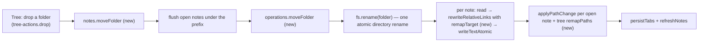

> **Update 2026-11-22 (E01-S08, informational toasts):** a rename or new-folder collision no longer shows inline in the dialog; the dialog closes and a toast shows the message. See `.ai/specs/2026-11-17-informational-toasts.md` (AC-08.1). Field validation stays inline.

# Rename, move and delete folders (E01-S05)

Prototype: `prototypes/workspace-basic/` (screen map: `prototypes/e01-screen-map.md`). The tree, its context menu and the delete confirmation already exist there; no new screens. Screen ids (s09, s10, …) refer to that map.

Source issue: #39 (E01-S05, epic #5). Depends on #16 (E01-S04, implemented in PR #28). Builds on `.ai/specs/implemented/2026-11-01-manage-notes-and-folders.md` (the "S04 spec"). Design authority: `.ai/specs/product-brief.md`. Engineering law: `AGENTS.md` and the standards spec.

## 📝 TLDR

The owner (the only confirmed user, D02) can already manage notes in the tree — rename, move by dragging, delete to the OS trash — but folders can only be created. This spec (future behavior) adds rename, move and delete for folders: the same name rules, collision policy, read-only handling and tab-following as notes, plus rewriting the relative links of the notes inside a moved folder. An owner decision on 2026-11-16 put this in E01 scope, superseding C-9 of the S04 spec.

## 📝 Decisions (owner)

| Id  | Topic                 | Decision                                                                                                                                                                                                                       |
| --- | --------------------- | ------------------------------------------------------------------------------------------------------------------------------------------------------------------------------------------------------------------------------ |
| D-1 | `attachments/`        | Stays hidden in the tree and therefore has no rename, move or delete action. The root name `attachments` is reserved for it: creating, renaming or moving a folder to a root-level `attachments` is refused (2026-11-16).        |
| D-2 | Keyboard              | No keyboard shortcuts for folder rename, move or delete now. Rename and delete are reachable through the context menu (Shift+F10 or the Menu key); move stays drag-only, consistent with the recorded exception for notes (2026-11-16). |
| D-3 | Delete confirmation   | One confirmation for every folder, empty or not. Its text says the folder and everything in it move to the trash (2026-11-16).                                                                                                  |
| D-4 | Inbound links         | Links in notes outside a moved folder that point into it are not rewritten, following S04 C-7 ("links in other notes that point at the moved note are not rewritten"; no backlinks, N03) (2026-11-16).                            |
| D-5 | Scope                 | Folder rename, move and delete are in E01 scope; this supersedes S04 C-9, which had excluded them (owner, 2026-11-16).                                                                                                          |

## 📝 Acceptance criteria

The issue's four criteria are refined below; the derived ones make the S04 rules explicit for folders. Screen ids refer to the screen map.

| Id      | Criterion                                                                                                                                                                                                                                                                                                                                                             | Screen   |
| ------- | ---------------------------------------------------------------------------------------------------------------------------------------------------------------------------------------------------------------------------------------------------------------------------------------------------------------------------------------------------------------------- | -------- |
| AC-05.1 | Given a folder, when the owner renames it from its context menu, then the directory is renamed on disk, every open tab of a note inside follows the new path, and a name colliding with a sibling (including case-only or Unicode-form-only) is rejected inline without changes. A case-only change of the folder's own name is allowed.                                | s10, s11 |
| AC-05.2 | Given a folder, when the owner drags it onto another folder or the workspace root, then the directory moves, every open tab of a note inside follows, the relative links of the notes inside are rewritten, and dropping it into itself or a descendant is refused.                                                                                                    | s14      |
| AC-05.3 | Given a folder, when the owner deletes it and confirms, then the folder and its contents are moved to the OS trash, the tabs of notes inside close after a save flush, and a failure or a read-only workspace changes nothing and shows an error.                                                                                                                      | s13      |
| AC-05.4 | Given an unsaved note inside a folder, when the owner tries to delete the folder, then the save is flushed, or the Save-failed dialog appears; cancelling it cancels the delete.                                                                                                                                                                                        | s13      |
| AC-05.5 | The workspace root has no rename, move or delete action. The hidden `attachments` folder has no row and therefore no action; a root folder named `attachments` cannot be created, renamed or moved into existence.                                                                                                                                                      | s10      |
| AC-05.6 | Given a folder with unsaved notes inside, when the owner renames or moves it, then the notes are flushed first; a failed flush cancels the operation with the save error (inline in the rename dialog, in the sidebar for a move).                                                                                                                                     | s10, s14 |
| AC-05.7 | Given an expanded folder, when it is renamed or moved, then it stays expanded and focused at its new path, and selected notes inside follow the new paths.                                                                                                                                                                                                             | s09      |
| AC-05.8 | Given a read-only or scope-denied workspace, when the owner renames, moves or deletes a folder, then the R-4 message shows and nothing changes on disk.                                                                                                                                                                                                                | s10–s14  |

## 📝 Not doing

- **Multi-select of folders.** Folders are not selectable (S04 AC-04.10); dragging a folder drags only that folder. Deferred by the issue.
- **Undo after delete.** No Toast with Undo (YAGNI; the issue's out of scope).
- **Permanent delete.** The OS trash is the only delete path (D-3 of S04); `remove` is never used as a fallback.
- **Folder icons.** Out of scope (the issue).
- **Keyboard shortcuts for folder move.** D-2.
- **Rewriting inbound links.** D-4.
- **A Move dialog.** Moving is by dragging, as for notes (S04 D-2).
- **Showing or managing `attachments/`.** D-1; the S03 policy is unchanged.

## 📝 Problem statement

After S04 the owner can manage notes but folders are create-only: a typo in a folder name is permanent from inside the app, folders cannot be reorganised, and an unwanted folder can only be removed in the OS file manager. The owner's E01 test findings (2026-11-16, issue #39) recorded this and put folder rename, move and delete in E01 scope, superseding S04 C-9. Evidence: issue #39; S04 spec C-9 and "Not doing" (folder operations out of E01); the owner's decision of 2026-11-16.

## 📝 Proposed solution

Extend the S04 machinery to folders rather than inventing a parallel one:

1. **Core.** Three new operations on the existing operations module, sharing its validation, collision and trash helpers with the note operations; a link-rewrite variant that remaps a destination inside the moved subtree before the new relative link is built.
2. **App.** Folder rows become draggable; drop validation refuses the folder itself and its descendants; the folder context menu gains Rename and Delete; the rename dialog and delete confirmation reuse the existing components with folder texts; unsaved notes inside the folder are flushed first (delete shows the Save-failed dialog on failure, per AC-05.4).
3. **UI.** Only the `Tree` drag behavior changes (folders become draggable); no new components.
4. **Rust.** No change.

Prior art: Obsidian, VS Code and the desktop file managers all treat folder rename, move and delete as first-class tree operations, and all of them refuse dropping a folder into itself or a descendant. The parts they add that this spec skips are backlink rewriting (Basalt has no backlinks, N03), trash configuration and permanent delete (S04 D-3), undo, multi-select and inline rename (the dialog matches the note flow).

Alternatives considered and rejected:

- **A separate `FolderOperations` module** — it would duplicate the collision, validation and listing logic that `createFolder` already shares with the note operations in `note-operations.ts`.
- **Rewriting inbound links from other notes** — D-4: Basalt has no backlinks (N03) and S04 C-7 set the precedent; it would touch notes the owner did not move.
- **Making `attachments/` a normal folder** — D-1: renaming it would break every image link, because no note moves when the folder itself is renamed.
- **Keyboard shortcuts for folder move** — D-2: consistent with the recorded exception to design-system rule 8 for notes.

## 📝 Architecture

- **`@basalt/core`.** `note-operations.ts` gains `renameFolder`, `moveFolder` and `deleteFolder` on `NoteOperations` (the module already owns `createFolder`), sharing `validateNoteName`, `pathKey` collision checks, `isDotEntry`, the listing lookups and `WorkspaceTrash`. `link-rewrite.ts` gains an optional `remapTarget` parameter so a destination inside the moved subtree is remapped before the new relative link is built; the existing note-move call sites pass no remapping and are unchanged. `HIDDEN_ROOT_FOLDERS` (already exported from `tree.ts`) becomes the reserved-name source for the root `attachments` rule. `WorkspaceFileSystem.rename` and `WorkspaceTrash.moveToTrash` already accept directories (the Tauri adapter uses `lstat` + `rename`; the `trash` crate documents "a single file or directory") — no port change.
- **`@basalt/app`.** `features/notes/notes-actions.ts` gains `renameFolder`, `moveFolder` and `deleteFolder` that flush the affected open notes, run the operation with the open sessions under the folder marked busy, follow path changes through the existing `applyPathChange` (prefix-mapped), persist tabs and refresh the tree. `features/tree/`: `tree-actions` gains folder branches in `requestMenu`, `startRename`, `confirmDelete`, `dragStart`, `dropTargetChange` and `drop`; `tree-store` gains `remapPaths(from, to)` and `prunePaths(prefix)` helpers (expanded, focused, selected, anchor); `TreeOverlaysContainer` derives the target kind from the tree for the dialog title, the validation kind and the confirmation text. `features/leave/`: a new `PendingLeave` kind `{ kind: "delete-folder"; path }` lets the Save-failed dialog retry, discard or cancel a folder delete; `failedNoteName` names the folder for it.
- **`@basalt/ui`.** `Tree` makes folder rows draggable (the `draggable` prop already exists; only the `!folder` guard and the note-only `dragstart` guard change). `RenameDialog`, `ConfirmDialog` and `ContextMenu` are reused; no new components.
- **`src-tauri`.** No change: `move_to_trash` already takes paths and validates them against the runtime workspace fs scope.



Takeaway: the directory rename is the only atomic step; link rewriting is per note and can stop midway, leaving the folder moved — the error names the folder and how many notes were rewritten (see Edge cases).

## 📝 Data model

No new entities and no persisted-format change. Folders are directories on disk; `TreeNode` already models folders; nothing new is written (no sidecars, no index, no settings — `BACKWARD_COMPATIBILITY.md` "Workspace on disk" is unchanged). The only state that changes is in memory: the tree store's expansion, focus and selection ids are remapped by prefix after a rename or move, and pruned after a delete. No data-model graph: this section adds or changes no entities.

## 📝 API contracts

```ts
// @basalt/core — note-operations.ts (new methods on the existing NoteOperations)
export interface RenameFolderInput {
    readonly path: WorkspacePath;
    readonly newName: string;
}
export interface MoveFolderInput {
    readonly path: WorkspacePath;
    readonly destinationFolder: WorkspacePath | null;
}
export interface FolderMove {
    readonly from: WorkspacePath;
    readonly to: WorkspacePath;
}

renameFolder(input: RenameFolderInput): Promise<Result<{ path: WorkspacePath }>>;
moveFolder(input: MoveFolderInput): Promise<Result<{ moved: FolderMove | null }>>;
deleteFolder(input: { readonly path: WorkspacePath }): Promise<Result<{ path: WorkspacePath }>>;

// @basalt/core — link-rewrite.ts (new optional parameter; existing callers unchanged)
export function rewriteRelativeLinks(
    text: string,
    oldNote: WorkspacePath,
    newNote: WorkspacePath,
    remapTarget?: (target: WorkspacePath) => WorkspacePath,
): string;

// @basalt/core — result.ts (new detail kinds)
type AppErrorDetail =
    | …existing…
    | { readonly kind: "flush-failed" }
    | { readonly kind: "folder-move-stopped"; readonly name: string; readonly moved: number; readonly total: number };
```

```ts
// @basalt/app — features/notes/notes-actions.ts
renameFolder(path: WorkspacePath, newName: string): Promise<Result<WorkspacePath>>;
moveFolder(path: WorkspacePath, destinationFolder: WorkspacePath | null): Promise<Result<FolderMove | null>>;
deleteFolder(path: WorkspacePath, options?: { readonly discard?: boolean }): Promise<Result<void>>;

// @basalt/app — features/leave/leave-store.ts
type PendingLeave = …existing… | { readonly kind: "delete-folder"; readonly path: WorkspacePath };

// @basalt/app — features/tree/tree-store.ts
function remapPaths(store: TreeStore, from: WorkspacePath, to: WorkspacePath): void;
function prunePaths(store: TreeStore, prefix: WorkspacePath): void;
```

`flush-failed` marks the error `deleteFolder` returns when the pre-delete flush failed; the tree action uses it to open the Save-failed dialog instead of the sidebar error, and the leave retry re-checks it. The dialog itself shows `errors.<code>` as the reason.

Validation, all before any disk change:

- **Common.** The path must exist in the listing, be a directory that is not a dot-entry, and not be inside a hidden root folder (`HIDDEN_ROOT_FOLDERS`, i.e. a root-level `attachments`) — `not-found` / `invalid-path`. The workspace root is not addressable (`toWorkspacePath("")` fails).
- **Rename.** `validateNoteName(newName)` valid, no leading dot, the target path valid; `pathKey` collision against the listing excluding the folder itself; a case-only change of the folder's own name is allowed; a root-level folder named `attachments` is refused (`invalid-path`, reserved for the attachment location, D-1). No link rewriting: renaming a folder within its parent changes no relative link, because every path under it shifts by the same parent segment.
- **Move.** The destination is `null` (the root) or an existing directory that is not a dot-entry and not inside a hidden root folder; `to = destination + "/" + baseName(from)`; a move that would create a root-level folder named `attachments` is refused (D-1); `to === from` or `to` inside `from` (the folder itself or a descendant) is refused with `invalid-path`; a `pathKey` collision in the listing is refused; a move to the current parent is a no-op (`{ moved: null }`) — the UI already treats the current parent as a non-target, so the core branch is defensive.
- **Delete.** The directory exists; one `trash.moveToTrash([path])` call; a failure changes nothing. The app flushes the notes inside first (AC-05.3, AC-05.4).

Execution:

- **Move.** One `fs.rename(from, to)` (atomic directory rename), then for every note under `to` (from the pre-move listing): read, rewrite with `remapTarget` (a destination inside the moved subtree is remapped; a destination outside it is not), and write with `writeTextAtomic` only when the text changed. A rewrite failure stops the run; the folder stays moved; the error carries `folder-move-stopped` with the folder name and how many notes were rewritten. No text is lost.
- **Delete.** One trash call for the directory; the app closes the tabs of the notes inside after the flush.

## 📝 UI/UX

- **Folder context menu:** New note, New folder, separator, Rename, Delete. The workspace root keeps New note and New folder. Shift+F10 or the Menu key opens the menu for the focused row (existing). Opening the folder menu does not change a note selection; folder actions act on the folder only.
- **Rename:** the existing `RenameDialog` with folder texts ("Rename folder"), the current name pre-filled, inline validation with the same `tree.nameError.*` messages, submit disabled while unchanged or pending, operation errors inline (`errors.*`). Keyboard-operable.
- **Delete:** one `ConfirmDialog` for every folder (D-3): title `Delete "{name}"?`, description "The folder and everything in it is moved to the trash."; Cancel has the initial focus (existing). On confirm: flush, delete, close tabs. On a failed flush: the Save-failed dialog, whose title names the folder; Retry retries the flush and continues, Discard deletes without saving, Cancel cancels the delete.
- **Drag:** folder rows are draggable; valid drop targets are another folder row or the workspace root; the target is highlighted only when valid; dropping onto itself or a descendant is refused (no highlight, drop ignored); dropping onto the current parent is a no-op; a collapsed target folder opens after 600 ms of hover (existing). Dragging a folder never drags a multi-selection (folders are not selectable).
- **After a rename or move:** the folder stays expanded and focused at its new path; selected notes inside follow; open tabs follow.
- **After a delete:** the tabs of the notes inside close; the active tab moves to the neighbour as for a normal tab close; ids under the deleted folder are pruned from the tree state.
- **Read-only or scope-denied:** the R-4 message; nothing changes.
- **Accessibility:** drag is pointer-only (the recorded exception to design-system rule 8, same as notes); rename and delete are reachable from the keyboard through the context menu; the dialogs are keyboard-operable; folder rows keep `aria-expanded`.
- **i18n keys:** new `tree.renameFolder.title`, `tree.delete.folderDescription`, `tree.move.folderLinksNotUpdated`, `saveFailed.folderTitle`, `tree.nameError.reserved-attachment`; the rest (`tree.menu.*`, `tree.nameError.*`, `tree.delete.title`, `errors.*`) is reused.

## 📝 Edge cases & failure scenarios

| Scenario                                                                 | Behaviour                                                                                                          |
| ------------------------------------------------------------------------ | ------------------------------------------------------------------------------------------------------------------ |
| Rename to a colliding name (case-only or Unicode form)                   | Rejected inline in the dialog; the dialog stays open; nothing changes.                                             |
| Rename to its own name with a different case                             | Allowed.                                                                                                           |
| Rename, create or move a root folder named `attachments`                  | Refused (`invalid-path`); the name is reserved (D-1).                                                              |
| Move `docs/attachments` to the root, or any operation on a path inside a hidden root folder | Refused (`invalid-path`); a hidden root folder cannot be created or addressed, even by a direct core call. |
| Rename or move a folder with unsaved notes inside                        | Flushed first; a failed flush cancels with the save error (dialog inline / sidebar).                               |
| Delete a folder with unsaved notes inside                                | Flush first; on failure the Save-failed dialog appears. Retry retries, Discard deletes without saving, Cancel cancels. |
| Move a folder into itself or a descendant                                | Refused: no highlight, the drop is ignored, and the core returns `invalid-path`.                                   |
| Move a folder onto its current parent                                    | No-op; the target is not highlighted.                                                                              |
| Move a folder where the name collides at the destination                 | Nothing changes; the message names the folder.                                                                     |
| Move a folder with notes whose links point outside the moved subtree     | Rewritten for the new depth.                                                                                       |
| Links between two notes that both move with the folder                   | Unchanged (both endpoints shift by the same prefix); the remap must not corrupt them.                              |
| Links from notes outside the moved folder into it                        | Not rewritten (D-4); they keep the old path.                                                                       |
| A link that resolves outside the workspace after the move                | Left unchanged (`invalid`).                                                                                        |
| A link to `attachments/…` in a moved note                                | Rewritten, because the note's depth changed.                                                                       |
| Link rewriting fails midway through a folder move                        | The folder stays moved; the error names the folder and how many notes were rewritten; no text is lost.             |
| Read-only or scope-denied workspace                                      | Every operation returns `permission-denied` / `scope-denied`; the R-4 message shows; nothing changes.              |
| Folder deleted outside the app while its context menu is open            | The operation reports `not-found`; the tree refreshes from the watcher.                                            |
| Folder removed outside the app while expanded                            | The watcher refresh drops the row.                                                                                 |
| Empty folder                                                             | Rename, move and delete work the same.                                                                             |
| A note inside the folder is open in a tab                                | Follows the rename or move; closes after the flush on delete.                                                      |
| Watcher events caused by the app's own folder operation                  | Open sessions under the folder are marked busy for the duration; the tree refreshes once from the explicit refresh. |
| A folder with a very large number of notes                               | Link rewriting is per note (read + write); a known cost, no batching planned.                                      |

## 📝 Risks & impact review

- **Hard to reverse:** none new. The workspace keeps its plain-files layout; no format change, no new metadata; the trash move is reversible by the OS. `BACKWARD_COMPATIBILITY.md` protected surfaces are untouched.
- **The link-rewrite remap is the risky part.** A wrong remap silently corrupts links in every moved note. Mitigation: a property test that for every note inside a moved folder and every relative link, `resolveLinkTarget(newNote, rewritten)` equals the remapped old target, plus the inside↔inside, inside↔outside and outside↔inside cases.
- **Inbound links break on a folder move** (D-4): a note outside the folder that links into it keeps a stale path. Recorded as a known limitation, not a defect; it follows S04 C-7 and N03.
- **`attachments/` stays hidden** (D-1): its images cannot be managed from the tree; the root name is reserved so a folder cannot become unreachable through a rename or move.
- **Performance:** a folder move rewrites every note inside; a folder with hundreds of notes does hundreds of read/write pairs. Acceptable for the MVP.
- **Public exports:** `NoteOperations` gains methods (additive; the interface already owned `createFolder` — no rename churn), `AppErrorDetail` gains two kinds, `rewriteRelativeLinks` gains an optional parameter. All additive; `describeMoveError` gains branches for the new details. Consumers update in the same PRs.
- **`Tree` behavior change:** folders become draggable; the prop surface is unchanged. Storybook stories and unit tests update.
- **`PendingLeave` gains a variant:** internal app type; no persisted format.

## 📝 Decisions in play

From `product-brief.md`: **D05** (MVP = local Markdown notes; folders are plain directories) and **N03** (no backlinks — supports D-4). No business rules exist yet. The owner decision of 2026-11-16 (folder rename, move and delete in E01) supersedes S04 C-9 and is recorded as D-5; the answers behind D-1…D-4 are the four gate answers. This spec proposes no further superseding entries.

## 📋 Phasing

1. **PR A, core.** `rewriteRelativeLinks` remap parameter, `renameFolder`, `moveFolder`, `deleteFolder`, unit and contract tests. No UI.
2. **PR B, app state.** Notes actions (`renameFolder`, `moveFolder`, `deleteFolder` with flush, busy and prefix path changes), tree store `remapPaths`/`prunePaths`, leave store `delete-folder` variant. No UI.
3. **PR C, rename and delete.** Folder context menu items, folder rename dialog, delete confirmation, Save-failed wiring. e2e for AC-05.1, 05.3, 05.4, 05.5, 05.6 (rename), 05.8.
4. **PR D, move.** Folder dragging, drop validation, focus and expansion remap. e2e for AC-05.2, 05.6 (move), 05.7, 05.8 (move), and the root menu offering no folder actions.

Closes #39 on PR D only.

## 📋 Implementation plan

Each step is testable and leaves the application working. Per phase: Vitest next to the code, Storybook where the `Tree` changes, Playwright in `basalt-app/e2e/` (a new `folders.spec.ts`), and the validation gate from `SDLC.md`.

**Phase A — core (PR A)**

1. `rewriteRelativeLinks` gains the optional `remapTarget`; property test: for a folder move, every relative link in a moved note resolves to the remapped target; existing note-move tests stay green.
2. `renameFolder`: validation, collision (case-only own rename allowed), reserved root name, hidden-root source, not-found and read-only tests.
3. `moveFolder`: self/descendant refusal, collision, no-op, hidden-root source and destination, link rewriting (inside↔inside unchanged, inside→outside rewritten, outside→inside untouched) and partial-failure tests.
4. `deleteFolder`: directory to trash, failure changes nothing, not-found tests.
5. Contract tests: a directory `rename` case in the shared file-system contract (run against the memory file system and the Tauri adapter fakes), a directory `moveToTrash` case for the memory trash fake, and a unit test that the Tauri trash adapter passes a directory path unchanged.

**Phase B — app state (PR B)**

6. Notes actions `renameFolder`, `moveFolder`, `deleteFolder`: flush, busy marking, prefix path changes, tab close after delete, refresh; tests with the in-memory file system.
7. Tree store `remapPaths` and `prunePaths`; tests.
8. Leave store `delete-folder` pending with retry, discard and cancel; `failedNoteName`; tests.

**Phase C — rename and delete (PR C)**

9. Folder context menu items and the folder rename dialog (kind derived from the tree, folder texts, inline validation); unit tests.
10. Folder delete confirmation and the Save-failed wiring; `describeMoveError` branches for the new details; e2e for AC-05.1, 05.3, 05.4, 05.5, 05.6 (rename), 05.8.

**Phase D — move (PR D)**

11. `Tree` folder dragging, drop validation (self/descendant), focus and expansion remap; Storybook and unit tests.
12. e2e for AC-05.2, 05.6 (move), 05.7, 05.8 (move): drag onto another folder and the root, tabs follow, links rewritten, refusals, read-only drag, and the root menu offering no folder actions.
