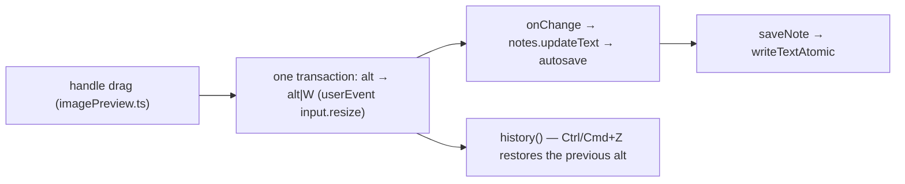

# The owner can resize images by dragging (E01-S12)

Prototype: `prototypes/workspace-basic/` (screen map: `prototypes/e01-screen-map.md`; screens s03 and s07). The prototype predates this story and has no resize handle; this spec is the design artifact.

Source issue: #40 (E01-S12, epic #5). Depends on: #10 (E01-S03, images in notes, implemented in PR #26). Builds on `.ai/specs/implemented/2026-10-25-images-in-notes.md` (the "S03 spec"), `.ai/specs/implemented/2026-11-08-live-preview-editor.md`, `.ai/specs/implemented/2026-11-01-manage-notes-and-folders.md` (the "S04 spec") and `.ai/specs/2026-11-16-note-name-follows-first-heading.md` (E01-S06). Design authority: `.ai/specs/product-brief.md`. Engineering law: `AGENTS.md` and `.ai/specs/implemented/2026-10-17-engineering-standards-package-structure.md` (the "standards spec").

## 📝 TLDR

The owner (the only confirmed user, D02) can add images (S03), but every image renders at its natural size scaled to the note column; the S03 spec deferred the resizing syntax (``) and the owner's E01 test findings (2026-11-16) put drag-to-resize in E01. This spec (future behavior) adds a resize handle to the image widget in live preview: drag it to set a pixel width, double-click (or Delete) to reset, with min/max bounds, one undoable document change per gesture, and the width stored in the alt text as an Obsidian-compatible `|300` suffix so the note stays valid Markdown and opens sized in Obsidian.

## 📝 Decisions (owner)

| Id  | Topic  | Decision                                                                                      |
| --- | ------ | --------------------------------------------------------------------------------------------- |
| D-1 | Scope  | Drag-to-resize images is expected in E01 (owner decision, 2026-11-16; recorded in issue #40). |

## 📝 Acceptance criteria

The issue's five criteria are refined below; the derived ones make the bounds, reset and keyboard behavior explicit. Screen ids refer to the screen map.

| Id      | Criterion                                                                                                                                                                                                                                                                                                    | Screen   |
| ------- | ------------------------------------------------------------------------------------------------------------------------------------------------------------------------------------------------------------------------------------------------------------------------------------------------------------ | -------- |
| AC-12.1 | Given an image shown in live preview, when the owner hovers it or the cursor is on its line, then a resize handle appears at its bottom-right corner; dragging it changes the displayed width and, on release, the source records `` in one undoable change.                                   | s07      |
| AC-12.2 | Given a note whose image has a stored width, when the note is reopened, then the image renders at that width (capped by the note column when wider) and the source still carries the suffix.                                                                                                                  | s07      |
| AC-12.3 | Given a missing image, then the placeholder shows, no handle is offered, and the note bytes are unchanged; when the file appears later, the stored width still applies.                                                                                                                                       | s07      |
| AC-12.4 | Given a resize, when the owner presses Ctrl/Cmd+Z, then the previous width (or the natural size after the first resize) is restored; redo reapplies it.                                                                                                                                                       | s03      |
| AC-12.5 | Given the stored syntax in another Markdown editor, then the note is still a valid CommonMark image link; the `\|W` suffix is read as alt text and the image renders at its natural size (documented limitation). In Obsidian the image renders at the stored width.                                          | s07      |
| AC-12.6 | The width is clamped to 40–2000 px; double-clicking the handle, or Delete/Backspace on the focused handle, removes the suffix and returns the image to its natural size.                                                                                                                                      | s07      |
| AC-12.7 | The handle is keyboard-operable: it is focusable, has an accessible name and a visible focus ring, and ArrowLeft/ArrowRight (∓10 px), Shift+Arrow (∓50 px), Home (40) and End (2000) adjust the width; each adjustment is one undoable change.                                                                | s03      |
| AC-12.8 | Given a note that is moved or renamed, then the width survives: `rewriteRelativeLinks` rewrites only the destination, the alt suffix is untouched.                                                                                                                                                            | s11, s14 |
| AC-12.9 | Given a read-only workspace, when the owner drags the handle, then the resize behaves like typing: the text changes locally, the save fails with the existing read-only error banner, and nothing changes on disk.                                                                                             | s03, s07 |

## 📝 Not doing

- **Cropping, rotating, aligning, image compression and optimization.** Out of scope (the issue).
- **Height control.** Width only; the browser keeps the aspect ratio. A `|WxH` suffix written by Obsidian is not interpreted (see Data model).
- **Percentage widths.** The suffix is pixels in Obsidian; a percent depends on the container and is not portable.
- **HTML `` output.** Rejected in Proposed solution; it would supersede S03 G2 and break link rewriting on move.
- **A width dialog, a context menu or a settings screen.** The handle, the keyboard and the reset are the only controls; no default width for pasted images.
- **Resizing reference-style images (`![alt][ref]`) and HTML ``.** No widget today (S03 G2); text unchanged.
- **Resizing images inside tables.** No handle; the block widget placement inside a table row is a pre-existing concern and needs its own story.
- **Touch and pen drag (E04).** Pointer-only, the same conscious exception to design-system rule 8 as the tree drag (S04 Not doing; S05 D-2); E04 owns touch.
- **Batch resizing of several images.** One image at a time.

## 📝 Problem statement

After S03 the owner can add images, but they all render at natural size capped by the note column (`max-width: 100%`), so a large screenshot dominates the note and a small one cannot be enlarged. The S03 spec explicitly deferred the resizing syntax ("Image resizing syntax (``)", Out of scope) and the owner's E01 test findings (2026-11-16, issue #40) recorded drag-to-resize as expected in E01. Evidence: issue #40; S03 spec Out of scope and Q5; the owner decision of 2026-11-16.

## 📝 Proposed solution

One vertical slice on top of the S03 widget:

1. **Core.** Pure helpers in `links.ts` (which already owns `formatImageLink`): the width bounds and `parseImageAlt` / `formatImageAlt` / `clampImageWidth`. No I/O, no port change.
2. **Editor.** `imagePreview.ts` renders a handle on the image widget, owns the drag (pointer capture, live `` width, no document change during the move) and dispatches exactly one transaction on release, replacing the alt range it was built from with `formatImageAlt(text, width)` and `userEvent: "input.resize"`. The rendering path (`resolve`/`refresh`) still never changes the document; only an explicit gesture on the handle does.
3. **App.** `NoteSessionEditor.tsx` passes the new `labels.resize` text; `locales/en.json` gains `attachments.resize.label`. Nothing else: the change flows through the existing `onChange` → `notes.updateText` → autosave → `saveNote` pipeline.
4. **Rust.** No change: no new command, permission or dependency.

Alternatives considered and rejected:

- **HTML ``.** Renders sized in GitHub, Obsidian and Typora, but replaces the Markdown image, which the widget does not render (S03 G2) and `rewriteRelativeLinks` does not rewrite (it handles `Link`, `Image` and `LinkReference` nodes only), so a moved resized note would break its image. It would supersede G2 and touch the widget, the loader and the rewriter; rejected.
- **Pandoc-style `{width=300}` attribute.** Keeps the `Image` node but no editor the owner uses renders it, and it needs new parsing outside the node; the S03 spec already named the pipe syntax; rejected.
- **A width dialog or a context menu.** Adds a surface for one number; the issue asks for drag; rejected.
- **Storing the width in `.basalt/` or a sidecar.** Violates "nothing but notes and attachments is written into the workspace" and portability (AC-12.5); rejected.

## 📝 Data model

- **On-disk syntax.** `` — the width is a decimal integer appended to the alt text after a `|`, for example ``. It is part of the alt text, so the link stays a valid CommonMark image link; the destination, escaping and relative-path rules are unchanged (S03 Link format). No sidecar, no `.basalt/` entry, no `basalt.json` change.
- **Parse rule.** The suffix is recognized only when the text after the last unescaped `|` is 1–4 ASCII digits forming a value in 40–2000; otherwise the whole alt is alt text. `|300x200` (Obsidian width×height) is not interpreted; `|0`, `|5000` and `|abc` are alt text. The bounds are the single source of truth in `@basalt/core`.
- **Portability.** Obsidian renders the stored width; editors without the extension show the image at natural size and read `alt|300` as the alt text (documented limitation, AC-12.5). The syntax is valid CommonMark, so the note always opens; no migration is needed (existing notes have no suffix; the suffix is optional).
- **In memory.** Nothing persisted beyond the note text; the widget derives `{ text, width }` from the raw alt with `parseImageAlt`. No new entity, so no data-model graph is produced.

## 📝 API contracts

```ts
// @basalt/core — links.ts (new; formatImageLink is unchanged)
export const MIN_IMAGE_WIDTH = 40;
export const MAX_IMAGE_WIDTH = 2000;
export function clampImageWidth(width: number): number; // round, clamp to [MIN, MAX]
export function parseImageAlt(alt: string): {
    readonly text: string;
    readonly width: number | null;
};
export function formatImageAlt(text: string, width: number | null): string; // strips an existing suffix, appends |W when width !== null
```

```ts
// @basalt/editor — imagePreview.ts
export interface ImageOptions {
    resolve(destination: string): Promise<ImageSource>;
    release(destination: string): void;
    labels: { loading: string; broken: string; resize: string }; // resize = the handle's accessible name
}
```

The widget dispatches internally; `MarkdownEditor` gains no method. The alt range and the parsed width travel from `build()` into `ImageWidget` (internal, not public API). `ImageWidget.eq` must include the alt range, not only destination and alt, so a position shifted by typing elsewhere rebuilds the widget instead of leaving a stale range for the next drag.

## 📝 Architecture

- **`@basalt/core`.** `links.ts` gains the constants and the three pure helpers; `formatImageLink`, `resolveLinkTarget`, `buildRelativeLink` and `rewriteRelativeLinks` are unchanged, so the S04/S06 link rewriting already preserves the suffix (it rewrites the `URL` node only).
- **`@basalt/editor`.** `imagePreview.ts`: `build()` slices the alt range as today, parses it with `parseImageAlt`, passes `{ altRange, width }` to `ImageWidget` and sets `img.alt` to the parsed text (without the suffix). The widget renders the handle for images (never for placeholders), owns pointer capture, updates only `img.style.width` while dragging, and on release dispatches one transaction replacing the alt range; `destroy` cancels a pending drag. `estimatedHeight` accounts for the stored width so scrolling does not jump. `theme` gains the handle styles from `--bs-*` tokens. `createMarkdownEditor.ts` is unchanged (labels already flow through `ImageOptions`). The package stays a leaf: no React, Tauri or `@basalt/*` imports.
- **`@basalt/app`.** `NoteSessionEditor.tsx` passes `labels.resize`; `locales/en.json` gains `attachments.resize.label` ("Resize image"). No store or action change: `onChange` → `notes.updateText` → autosave → `saveNote` → `writeTextAtomic` persists the new text, and the watcher ignores the app's own write by content (S01). The read-only case needs no plumbing: it behaves like typing (AC-12.9).
- **`src-tauri`.** No change.



Takeaway: the resize is an ordinary document edit; persistence, watcher suppression and undo reuse the existing pipelines.

## 📝 UI/UX

- **Handle (s07).** A small square at the bottom-right corner of the image, `cursor: nwse-resize`, revealed when the pointer hovers the widget, when the image's line is an active line (the existing `activeLineNumbers` set), or when the handle has focus; hidden otherwise but always in the DOM so it stays focusable. It is not rendered for placeholders, for reference-style images or HTML `` (no widget, S03 G2), inside tables, or when the editor is read-only.
- **Drag.** Pointerdown captures the pointer; the starting width is the currently displayed width (the stored width, or the natural width scaled to the column); pointermove updates the `` width live with no document change; pointerup commits one transaction. Escape or pointercancel restores the starting width and writes nothing. A document change during the drag (typing, watcher reload) rebuilds the widget and ends the drag without committing.
- **Reset.** Double-click the handle, or Delete/Backspace on the focused handle, removes the suffix (natural size) in one transaction.
- **Keyboard (s03).** The handle is `tabindex="0"` with `role="slider"`, `aria-valuemin/max/now`, `aria-orientation="horizontal"` and the `attachments.resize.label` accessible name; `aria-valuenow` is the current effective width (the stored width, or the natural width clamped); the focus ring uses `--bs-focus-ring`. ArrowLeft/ArrowRight ∓10 px, Shift+Arrow ∓50 px, Home → 40, End → 2000, Delete/Backspace → reset. Each adjustment is its own undo step (CodeMirror's history joins only `input.type`/`delete` events, so `input.resize` steps stay separate and predictable).
- **Undo/redo.** The existing `history()` / `historyKeymap`; Ctrl/Cmd+Z restores the previous width, Shift+Ctrl/Cmd+Z reapplies it; a drag is one step.
- **Display.** Only `width` is set; the existing `.cm-image-preview` rule keeps `height: auto`, so the aspect ratio is preserved and the column still caps the display.
- **i18n.** `attachments.resize.label` = "Resize image"; the handle's `title` uses the same text. All text comes from `locales/en.json` through `ImageOptions.labels` (the editor has no i18n).
- **Accessibility note.** Tab now reaches each image handle (the editor binds no Tab key), so the handles are reachable without a pointer; the widget box itself stays non-focusable and does not trap the cursor.

## 📝 Edge cases & failure scenarios

| Scenario                                                                 | Behaviour                                                                                                                       |
| ------------------------------------------------------------------------ | ------------------------------------------------------------------------------------------------------------------------------- |
| Missing image (AC-12.3)                                                  | Placeholder; no handle; bytes unchanged; when the file returns, the stored width applies.                                       |
| Reference-style image (`![a][ref]`) or HTML ``                      | No widget, no handle; text unchanged (S03 G2).                                                                                  |
| Query or fragment URL (``)                          | The widget resolves and displays it; a resize rewrites only the alt, the destination keeps its `#frag`/`?query`.                 |
| Image inside a link (`[](note.md)`)                           | The widget already renders it; the handle edits the inner image's alt, the outer link is untouched.                             |
| Image inside a table                                                    | No handle (deferred); the source is unchanged.                                                                                  |
| Image inside a code block                                                | No widget (existing); no handle.                                                                                                |
| Resize, then move or rename the note (AC-12.8)                           | `rewriteRelativeLinks` rewrites only the destination; the suffix survives.                                                       |
| Undo after a resize (AC-12.4)                                            | The previous alt (with or without a suffix) is restored; redo reapplies the new width.                                          |
| Undo after a reset                                                       | The suffix returns.                                                                                                             |
| Document changes during a drag                                           | The widget is rebuilt, the drag ends, nothing is committed.                                                                     |
| External edit while the note is clean                                    | The editor reloads the disk text; the widget shows the new width. Dirty: the existing conflict banner.                          |
| Read-only workspace (AC-12.9)                                            | The text changes locally; the save fails with `permission-denied` and the existing banner; nothing changes on disk.             |
| Editor created with `readOnly: true`                                     | No handle is rendered.                                                                                                          |
| Hand-written `\|5000`, `\|0`, `\|abc`, `\|300x200`                       | Not recognized; the whole alt is alt text; the image renders at natural size.                                                   |
| Escaped pipe in the alt (``)                             | Not a size separator; the alt is unchanged.                                                                                     |
| Empty alt with a suffix (``)                              | Width 300, alt empty; a reset returns to ``.                                                                          |
| Image wider than the column                                              | Display is capped by `max-width: 100%`; the stored width may be larger; the drag starts from the displayed width.               |
| Natural width below 40 px                                                | A set width is clamped to 40; reset returns to the natural size.                                                                |
| Two images, or two images on one line                                   | Each widget has its own handle; dragging one edits only its own alt range.                                                      |
| Save fails after a resize (conflict, read-only, too large)               | The existing banner shows; the text is never discarded (S01 rule).                                                              |
| Watcher event caused by the resize                                       | Ignored by content (`baseText` comparison), as for typing.                                                                      |

## 📝 Risks & impact review

- **Hard to reverse:** the width suffix ends up in the owner's notes. Mitigated by valid CommonMark (the note always opens), by the parse rule (unrecognized suffixes stay plain alt text), by the reset gesture, and by the fact that the suffix is optional — no migration is needed. The choice is flagged ⚠ in the assumptions table.
- **The widget now changes the document.** A bug could corrupt the alt text. Mitigation: the widget replaces exactly the alt range it was built from; `eq` includes that range so a shifted position rebuilds the widget; one transaction per gesture; tests assert the exact source bytes.
- **Alt-text pollution in other editors** (`alt|300`): documented limitation (AC-12.5); Obsidian renders it correctly.
- **Market check (general knowledge, not freshly verified, 2026-11-17).** Obsidian stores `` (pixels; `|WxH` is also supported) and renders it; Typora writes HTML `` or `style="zoom"`; Joplin's WYSIWYG stores HTML `` with a width; GitHub renders `` but not the pipe suffix. Basalt takes Obsidian's syntax because the owner's reference editor is Obsidian (S03 market check) and because it keeps the `Image` node intact for the widget, the loader and the link rewriter.
- **Public exports:** `@basalt/core` gains three functions and two constants (additive); `ImageOptions.labels` gains a required `resize` key — a type change for the one consumer, `NoteSessionEditor.tsx`, updated in the same PR (`@basalt/editor` is private to the monorepo). `BACKWARD_COMPATIBILITY.md` "Workspace on disk" is respected: notes stay plain Markdown.
- **Accessibility:** the handle adds a focusable element inside the editor content, so Tab now reaches each image handle. Accepted: it gives keyboard access (AC-12.7) and the widget box itself stays non-focusable.
- **Performance:** the drag updates one CSS property; one transaction per release. No per-move document changes, no re-resolve.
- **What tests can and cannot prove.** Playwright on the memory platform can drive pointer events on the handle and assert the saved bytes; it cannot prove real OS pointer behavior on built apps — the same limit as S03/S04.

## 📝 Decisions in play

- **D05** (images in notes are in the MVP) — this spec refines how they are sized.
- **D02** (built for the owner first) — justifies the Obsidian-compatible syntax and the pointer-first interaction.
- **N01** (no iOS/web in the MVP) — touch is deferred to E04.
- **N03** (no backlinks) — no relation; the resize is not a backlinks feature.
- S03 **G2** (reference-style images and HTML `` have no widget) stays as-is. S03's Out of scope ("image resizing syntax") is fulfilled by this spec, which picks exactly the anticipated `` form; nothing is superseded. The persisted-syntax choice is a new contract, flagged for the owner in the assumptions table.

## Resolved assumptions (autonomous defaults)

The issue's Open questions are resolved below with the most reversible, lowest-blast-radius answers; the derived rows cover decisions the issue left implicit. ⚠ marks a call the owner should confirm before implementation.

| Id  | Question                                     | Chosen answer                                                                                                                                                                                       | Rationale                                                                                                                          |
| --- | -------------------------------------------- | ---------------------------------------------------------------------------------------------------------------------------------------------------------------------------------------------------- | ---------------------------------------------------------------------------------------------------------------------------------- |
| Q1  | Storage syntax for portability               | ⚠ NEEDS HUMAN CONFIRMATION. Obsidian pipe suffix ``, pixels.                                                                                                                   | Valid CommonMark, matches S03's anticipated syntax and the owner's Obsidian; keeps the `Image` node so the widget, loader and link rewriter stay unchanged. HTML `` would supersede G2 and break move-rewrite. |
| Q2  | Width only, or width and height              | Width only; the browser keeps the aspect ratio; `\|WxH` is not interpreted.                                                                                                                          | The issue's scope is width; height doubles the syntax and the drag logic.                                                          |
| Q3  | Touch (E04)                                  | No; pointer (mouse/pen) only, like the tree drag exception.                                                                                                                                          | E04 is parked; adding touch now would guess its interaction model.                                                                 |
| Q4  | Reference-style images and query/fragment URLs | Reference-style: no widget or handle (S03 G2, unchanged). Query/fragment: the handle works; only the alt is rewritten, the destination keeps its suffix.                                             | Reuses `resolveLinkTarget`'s existing stripping; no new parsing.                                                                   |
| Q5  | Images inside links or tables                | Inside links: handle available (the widget already renders them). Inside tables: no handle.                                                                                                          | A block widget inside a table row is a pre-existing concern; resizing there needs its own story.                                   |
| Q6  | Min/max and the reset gesture                | 40–2000 px; double-click or Delete/Backspace resets; Escape cancels a drag.                                                                                                                           | 40 keeps the handle usable; 2000 is a portable upper bound (the column caps display at 700); reset is the inverse of the write.     |
| Q7  | Undo granularity                             | One transaction per drag release; one per keyboard adjustment.                                                                                                                                       | CodeMirror's history joins only `input.type`/`delete` events, so `input.resize` steps stay separate and predictable.               |
| Q8  | Read-only workspace and `readOnly` editors   | Read-only workspace: behaves like typing (local text, save-error banner, nothing on disk). `readOnly: true` editor: no handle.                                                                       | Consistent with the existing editor behavior; no new read-only plumbing into the editor.                                           |

## 📋 Phasing

1. **PR A, core.** The width constants and `parseImageAlt` / `formatImageAlt` / `clampImageWidth`, plus a link-rewrite regression test with a suffixed alt. No visible change.
2. **PR B, editor and app.** The handle, drag, keyboard, reset, theme, `labels.resize`, the i18n key and the e2e suite. Closes #40.

## 📋 Implementation plan

Each step is testable and leaves the application working. Vitest next to the code, Playwright in `basalt-app/e2e/` (a new `resize-images.spec.ts`; the existing `images.spec.ts` and `add-images.spec.ts` stay green), and the validation gate from `SDLC.md`.

**Phase A — core (PR A)**

1. `MIN_IMAGE_WIDTH`, `MAX_IMAGE_WIDTH`, `clampImageWidth`: rounding and clamping at both ends. Tests in `links.test.ts`.
2. `parseImageAlt`: plain alt; `|300`; empty alt with a suffix; escaped `\|`; `|300x200`; `|0`, `|5000`, `|abc`; a trailing `|`; several pipes (the last unescaped wins); non-ASCII alt. Tests.
3. `formatImageAlt`: appends, replaces and removes the suffix; preserves the rest byte-for-byte; idempotent. Tests.
4. Regression: `rewriteRelativeLinks` on a note with a suffixed alt rewrites only the destination and keeps the suffix (note moved between folders). Tests in `link-rewrite.test.ts`.

**Phase B — editor and app (PR B)**

5. `imagePreview.ts`: `build()` parses the alt and passes the alt range and width to `ImageWidget`; `img.alt` uses the parsed text; `eq` includes the alt range; `estimatedHeight` accounts for the width. Tests in `imagePreview.test.ts`: no handle for placeholders or a read-only editor; `img.alt` without the suffix; a shifted alt range rebuilds the widget.
6. Drag: pointerdown/move/up with pointer capture, live `` width, clamping, one transaction on release (`userEvent: "input.resize"`), Escape/pointercancel/destroy cancel. Tests with synthetic pointer events: drag right and left, clamp at min and max, cancel writes nothing, exactly one transaction per drag, the committed text is exact.
7. Reset and keyboard: double-click; Delete/Backspace; the `role="slider"` attributes and accessible name; Arrow/Shift+Arrow/Home/End; the focus ring. Tests.
8. Theme: the handle styles use `--bs-*` tokens only; `npm run check:tokens` stays 0; visible on hover, active line and focus, hidden otherwise. Tests.
9. App: `ImageOptions.labels.resize` from `NoteSessionEditor.tsx`; `attachments.resize.label` in `locales/en.json`; the i18n key test stays green. Tests.
10. e2e (`resize-images.spec.ts`): hover shows the handle; a drag saves ``; reopening keeps the width; reset removes the suffix; undo restores the previous width; a keyboard resize; a missing image keeps the placeholder and unchanged bytes; read-only behaves like typing; moving the note to a sub-folder keeps the suffix and rewrites the destination (AC-12.8); the saved source is asserted byte-for-byte (AC-12.5).
11. Docs: the README workspace section gains the width suffix; the run log and any lesson follow `.ai/AGENTS.md`. No implemented spec is edited.
